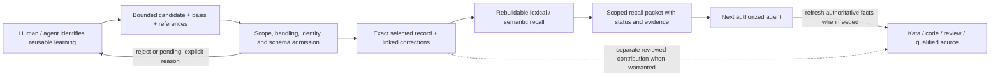

# Selective engineering memory

**Date:** 2026-10-26. **Tracking:** engi-platform Kata `qt7g`.
**Status:** proposed contract/pilot with disabled Hindsight preparation under
`svg1`; no installed service or adopted vendor.
Companion: [system architecture](system-architecture.md).

## Value gate before implementation: 2026-10-27, 23:00

The owner explicitly permits skipping memory if it does not add useful value.
Existing `zbww` compares no added memory, simple structured records and at most
one suitable approved drop-in; it does not require building our own runtime
or deploying multiple backends. Agree the rubric and effort/model budget first.
Measure held-out second-session task quality, repeated investigation avoided,
false/stale recall, corrections, latency and total integration/operating cost,
under comparable conditions. Retrieving a planted string is not task benefit.

A positive decision may justify only a thin adapter. A negative/inconclusive
result does not release `pbqn` merely because evaluation is closed: that task
is conditional P2 and must be narrowed, deferred or retired accordingly.
The three-product demo `hk33` works without memory; add a lesson-use/correction
scene only if useful. Existing privacy/scope/recovery requirements still apply
to any selected candidate. No backend has been adopted or launched by this
decision; research and disabled preparation below remain historical evidence.

## Disabled Hindsight preparation: 2026-10-26 (svg1)

The owner's 18:28 approval covers preparation, not a launch, model call or
unattended capture. The separate
[`dist/hindsight.compose.yaml`](../dist/hindsight.compose.yaml) and
[blank selectors](../dist/hindsight.env.example) are **not** part of the four
managed services or installer. They have no automatic startup/update, default
active profile, control plane, MCP registration, conversation/history import
or source checkout mounts. No existing Pi configuration or credential was read
or copied during this preparation.

### Verified upstream contract and pin

GitHub's latest stable, non-prerelease release on October 26 is
[v1.1.0](https://github.com/vectorize-io/hindsight/releases/tag/v1.1.0), published
October 21, resolving to commit
`a5a619b5ca59c5c39e0f96be6f7a31fabd136bd5`. The API-only full image is pinned to:

```text
ghcr.io/vectorize-io/hindsight-api:1.1.0@sha256:cdfeb26e92ad33d54a8a7e4cfe6e67b55d619f25ea5f5bba0a3281d701a82b36
```

Public registry metadata lists Linux amd64/arm64. Its returned manifest bytes
match that SHA-256. No image layers were pulled, signature verified, image
executed or runtime compatibility demonstrated. The digest freezes the image,
including its bundled local models; it does not replace provenance review.

Contract evidence below is from that release commit, not moving `main` docs:

- [Installation and image variants](https://github.com/vectorize-io/hindsight/blob/a5a619b5ca59c5c39e0f96be6f7a31fabd136bd5/hindsight-docs/docs/developer/installation.md),
  [image build](https://github.com/vectorize-io/hindsight/blob/a5a619b5ca59c5c39e0f96be6f7a31fabd136bd5/docker/standalone/Dockerfile)
  and [startup](https://github.com/vectorize-io/hindsight/blob/a5a619b5ca59c5c39e0f96be6f7a31fabd136bd5/docker/standalone/start-all.sh):
  API-only image, embedded PostgreSQL/pg0 storage at `/home/hindsight/.pg0`,
  unprivileged UID 1000 and named-volume ownership seeding.
- [Configuration](https://github.com/vectorize-io/hindsight/blob/a5a619b5ca59c5c39e0f96be6f7a31fabd136bd5/hindsight-api-slim/hindsight_api/config.py)
  and [initialization](https://github.com/vectorize-io/hindsight/blob/a5a619b5ca59c5c39e0f96be6f7a31fabd136bd5/hindsight-api-slim/hindsight_api/engine/memory_engine.py):
  distinct extraction/embedding/reranker settings; startup normally verifies
  LLM connectivity, and LLM request tracing defaults to **enabled**.
- [Built-in tenant extension](https://github.com/vectorize-io/hindsight/blob/a5a619b5ca59c5c39e0f96be6f7a31fabd136bd5/hindsight-api-slim/hindsight_api/extensions/builtin/tenant.py)
  and [MCP authentication](https://github.com/vectorize-io/hindsight/blob/a5a619b5ca59c5c39e0f96be6f7a31fabd136bd5/hindsight-api-slim/hindsight_api/api/mcp.py):
  missing service key fails initialization; one valid bearer key selects one
  schema, **not** a project-specific/read-only permission. Legacy MCP-token
  authentication is a separate path.
- [REST retain/recall/export](https://github.com/vectorize-io/hindsight/blob/a5a619b5ca59c5c39e0f96be6f7a31fabd136bd5/hindsight-api-slim/hindsight_api/api/http.py):
  explicit retain supports `async:false`; reusing a `document_id` performs an
  upsert/replacement, not our proposed conflicting-retry rejection contract.

### Proposed configuration, not deployment/model authorization

This small template proposes one API-only container and an **external named
volume**. Volume name, dedicated private env-file path, extraction
provider/model/endpoint, and both local model identities are intentionally
blank and required. Compose refuses incomplete selectors or a missing env
file. `pull_policy: never` requires a separately approved image acquisition.
The `hindsight` profile and explicit `-f` opt-in are operational safeguards,
not access controls; explicitly naming a service can activate its profile.

Only `127.0.0.1:18888` is published. The API binds `0.0.0.0:8888` **inside**
its ordinary container network; no database/UI port, host networking or Docker
socket is exposed. Loopback is not authentication or an outbound firewall.
Host administrators, Docker operators and authorized local processes remain
part of the trust boundary. Verify the port is free before launch.

| Processing | Prepared boundary / outstanding choice |
| --- | --- |
| Retain extraction | Required explicit provider, model and credential-free base URL; dedicated approved LLM credential comes from the private env file. The existing Pi/USAi route does not prove Hindsight's client/schema/protocol compatibility or authorize this new use. |
| Embeddings | Proposed in-process CPU `local`, not the extraction endpoint. Full upstream image bundles `BAAI/bge-small-en-v1.5`; operator must explicitly approve/select it. |
| Reranking | Proposed in-process CPU `local`, independently of extraction/embeddings. Full image bundles `cross-encoder/ms-marco-MiniLM-L-6-v2`; operator must explicitly approve/select it. |
| Downloads and background work | Hugging Face offline/telemetry flags and disabled remote-code trust prevent the proposed local providers from downloading missing models. Startup LLM verification, automatic consolidation, observations, decision model, file-upload API, request traces, debug dumps and access/audit/OTel traces are disabled. A health check is not a model validation. |

Local providers are a conservative **proposal**, not a settled model choice.
If local models are not approved or absent from the verified image cache,
stop: do not clear offline flags or silently fall back to a public provider.
An approved external embedding/reranking alternative needs a revised template
and separate endpoints, credentials and traffic tests. Likewise, no
per-operation LLM override, stored bank override, remote parser or webhook is
approved. Disabling traces does not prove every error log is body-free.

### Launch gates (all unresolved until recorded evidence)

1. Explicit approval to acquire/run this exact image on an approved **local**
   Docker daemon; confirm architecture, capacity, image signature/provenance
   and Compose support for `env_file.format: raw` (Compose 2.30+). No runtime or
   global package installation is part of this preparation.
2. Approve extraction route/protocol/model and both local model identities,
   permitted egress and a synthetic model-call budget. Verify outbound
   destinations and no downloads/provider fallback before accepting private
   content. No credential-bearing URLs or default public model endpoint.
3. Provision a **new, empty, dedicated** private volume and separate service
   key. Approve Docker-data-root permissions/encryption, encrypted backup
   location, retention/erasure and restore procedure. Do not reuse an unknown
   volume: restored queued work and bank configuration can change processing.
4. Approve authentication/authorization topology. Built-in bearer auth grants
   every holder access to every bank in its schema, including writes/config;
   it cannot meet two-project/different-audience or reader/writer isolation.
   A first synthetic exercise may use a single trusted scope. Real multi-scope
   use needs separately isolated deployments/keys or a reviewed tenant
   solution. The upstream
   [static-keys extension](https://github.com/vectorize-io/hindsight/blob/a5a619b5ca59c5c39e0f96be6f7a31fabd136bd5/hindsight-extensions/static-keys-tenant/README.md)
   requires a custom build; it is not included or selected here.
5. Exercise absent/wrong/valid/revoked credentials and cross-scope guessed
   IDs, list/get/recall/export/write/config paths against the chosen topology.
   Test persistence/restart/restore and exact-record export/corrections.
   Bank IDs, URL paths and metadata filters are **not authorization**.
   Offline Compose checks do not establish any of these runtime guarantees.
6. Before real capture, approve the bounded record admission/handling policy
   below and prove rejection before model processing. Stock API/file-upload
   settings are not a secret scanner or a selected-record admission layer.
   Keep exact selected submissions separately in approved private storage
   until export, correction and retry semantics satisfy the contract.

### Future operator procedure — not executed or authorized by this document

After the gates above are approved, provision `.local/hindsight/` as mode 0700
and copy `dist/hindsight.env.example` to `.local/hindsight/compose.env`, mode
0600. Fill only approved **non-secret** selectors; the private env path must
be absolute. Provision that separate mode-0600 raw env file by approved secret
handoff with only `HINDSIGHT_API_TENANT_API_KEY` and, for the approved
key-authenticated extraction provider, `HINDSIGHT_API_LLM_API_KEY`.
The two credentials have different purposes. No literal key belongs in
commands, shell history, tracked files or logs. No `_FILE` support is assumed.

The private env file is external to the repository's tracked distribution,
not a new secret manager. `format: raw` avoids dollar interpolation; do not
shell-source it or quote values. Docker administrators can inspect container
environment. Do not run unredacted `docker inspect`, `compose config` or
`config --environment` on real configuration; use **`config --quiet`**.
The tracked test suite renders synthetic values only.

Check the selected Docker context is local and approved. Explicitly create
the named volume selected in `compose.env` using native `docker volume create
APPROVED_PRIVATE_VOLUME`; verify its protected storage location. Acquire only
the exact image reference shown above with native `docker pull` after
provenance approval. Then, from this repository root:

```sh
umask 077
docker compose --env-file .local/hindsight/compose.env \
  -f dist/hindsight.compose.yaml --profile hindsight config --quiet
docker compose --env-file .local/hindsight/compose.env \
  -f dist/hindsight.compose.yaml --profile hindsight up -d --pull never hindsight
docker compose --env-file .local/hindsight/compose.env \
  -f dist/hindsight.compose.yaml --profile hindsight ps
curl --fail --silent --show-error http://127.0.0.1:18888/health
```

Check ready state, authentication and actual bound ports; stop on mismatch.
No inference is proved by health, and startup verification is deliberately
skipped. No boot service, automatic restart or worker integration is added.

After separate approval for synthetic retain/recall, prepare a mode-0600
`.local/hindsight/client.header` containing the dedicated service bearer
header via the approved secret handoff, not an expanded shell argument.
Save a small synthetic `.local/hindsight/retain.json`, for example:

```json
{"async":false,"items":[{"content":"Synthetic proposed decision: retry once after checking the fixture version.","document_id":"synthetic-001","metadata":{"project":"synthetic-a","basis":"proposed","kind":"decision"}}]}
```

Use this only as a transport fixture, not a complete accepted memory record:

```sh
curl --fail --silent --show-error --header @.local/hindsight/client.header \
  --header 'Content-Type: application/json' --data-binary @.local/hindsight/retain.json \
  http://127.0.0.1:18888/v1/default/banks/synthetic-a/memories \
  --output .local/hindsight/retain-response.json
curl --fail --silent --show-error --header @.local/hindsight/client.header \
  --header 'Content-Type: application/json' \
  --data '{"query":"What should be checked before retrying?","budget":"low","max_tokens":512,"trace":false}' \
  http://127.0.0.1:18888/v1/default/banks/synthetic-a/memories/recall \
  --output .local/hindsight/recall-response.json
```

Keep response files private; inspect actual IDs/readiness and retained basis,
not just HTTP success. Do not treat an upsert as immutable correction history.
MCP stays off; adding explicit MCP retain/recall later requires its own
authenticated tool-surface tests, not the coding-agent integration installer.

Stop cleanly without deleting data:

```sh
docker compose --env-file .local/hindsight/compose.env \
  -f dist/hindsight.compose.yaml --profile hindsight stop --timeout 60 hindsight
docker compose --env-file .local/hindsight/compose.env \
  -f dist/hindsight.compose.yaml --profile hindsight down
```

The external volume survives `down`; do not use `volume rm`, pruning or
destructive reset as rollback. Before any future upgrade, stop writes, take a
consistent encrypted backup of the stopped volume plus exact submissions and
record the image/config identity. Restore only into a separately approved
isolated volume, recheck deletion/revocation and stored settings, and verify
before switching. Do not point an older image at a migrated live database.
No automated upgrade/backup job is prepared here.

### Preparation validation and shutdown

`python3 -m unittest discover -s dist -p test_hindsight.py -v` checks the
configuration offline using synthetic env files and a nonexistent Docker
socket: all **7 tests pass**, covering profile inactivity, blank/missing gates,
digest pin, loopback publication, external persistent volume, literal secret-file loading and
explicit model/privacy controls. Docker Compose v5.6.0 is present; no
dependency installation was needed. All 31 `HINDSIGHT_API_*` template names
were also checked against the pinned configuration/tenant source.
These optional checks explicitly skip when Docker/Compose is absent; the
existing four-service distribution does not acquire a Docker prerequisite.

These are configuration-contract checks, **not** running-service/model,
authorization, persistence or usefulness acceptance. No Hindsight process,
container, network, volume, image download, live memory/model request or
coding-agent integration was created. Existing four services and global
configuration were untouched; no experimental process needs shutdown.
Parent integrated the preparation in f2ffd9e; exact review 103 passes.
Native `svg1` is closed for preparation only. The bounded coding pilot jgcf
is also complete; neither closure removes the explicit launch gates for zbww.

## Post-onboarding placement and candidate recommendation (kamh)

Hindsight remains the first **service candidate to evaluate**, not a proven
winner or adopted dependency. Its self-hosted API/MCP, explicit retain/recall
operations and documented Pi/Copilot integrations fit a shared endpoint used
by different engineering agents. Mem0 remains the comparison candidate;
structured selected records remain the lower-complexity baseline. No local
head-to-head result establishes that any service is better for this workflow.

Run the bounded pilot below after the first real Engineer workflow yields
concrete handoff/repeated-investigation questions; it need not wait for Drive
or all ingestion work. Recall can support refinement, investigation, coding
and review. Capture selected corrections, attempts and handoffs, not every
phase transition. Centralize access while enforcing project/audience scope,
not one unrestricted memory bank for every project.

Primary documentation rechecked on October 26 still says the standard
coding-agent integration automatically ingests conversations/git history and
auto-updates, while MCP authentication is off by default. Prefer pinned,
explicit API/MCP contributions for our pilot, with approved extraction and
embedding routes and exercised authorization. Do not install the default
integration or assume self-hosting means no outbound model processing.
Recall is advisory; no memory service becomes Kata, roborev, Librarian or SPUD.

## Purpose: remember useful context, not everything that happened

An agent should resume with the decisions, corrections, failed approaches and
conditions that would otherwise have to be rediscovered. The unit is a
**bounded, attributable learning or handoff**, not a conversation, tool call
or exhaustive execution trace.

This narrows the earlier `8cne` action-ledger research. Keep exact submitted
memory records and their evidence references; do **not** require capture of
every underlying action. No event bus, universal hook layer, tamper-proof
ledger or replay of an entire coding session is needed for the first version.
Full forensic reconstruction is a different requirement.

Engineer owns this capability. Librarian still owns supported institutional
knowledge; SPUD/source control owns revision-bound technical context; Kata owns
current task state; roborev owns review results; AgentsView owns its session
visibility. A memory records a dated experience with these systems, not a
competing live status register.

## What deserves capture?

Capture only when it would change another authorized agent's next decision,
prevent material repeated investigation, or make unfinished work resumable.
Record a short reason for reuse. Ordinary execution remains in its native
system. A useful record can refer to a private source without copying its body,
but even its summary and locator inherit applicable handling restrictions.

| Kind | Capture trigger and useful payload | Exclude / qualification |
| --- | --- | --- |
| Decision | Human-approved choice, rationale, alternatives rejected and applicability | A suggestion is `proposed`, not an accepted decision; memory grants no permission |
| Correction | A human or inspected source corrects an earlier assumption; link affected records | Preserve who corrected what and whether it is reported or verified |
| Attempt outcome | A non-obvious approach failed/succeeded under stated conditions and should inform retries | Not every command result; bind environment/revision and relevant result evidence |
| Procedure | A repeatable workaround or engineering convention with observed verification | Scope to tested versions/environment; invalidate on relevant change |
| Handoff | Unfinished question, work already done, current limitation and concrete next action | Task state is refreshed from Kata; do not close or assign work through memory |
| Context gap / contribution | Missing or conflicting evidence materially affects the task; link contribution and disposition | A search miss is not proof of absence; business findings still enter Librarian review |

Examples of useful *shapes*: a rejected integration approach and why; an exact
provider compatibility condition; a human correction to scope; where an
investigation stopped and the smallest next experiment. Avoid routine
"read file", "test passed", greetings, repeated summaries, complete prompts,
hidden reasoning, access tokens or wholesale tool output.

Institutional claims discovered during work have a separate promotion route:
memory can remember that a contribution was submitted, but only Librarian's
actual disposition establishes incorporation. Do not use the review-event
schema/store as a general engineering-memory database.

## Capture and recall flow



Start with an explicit `remember`/handoff contribution at a real decision or
session checkpoint. Later harness hooks may prompt for or submit **selected**
records at compaction/handoff, material failure or human correction. They must
not backfill all sessions or stream all tool results. A hook can verify
submission, not whether an agent identified every worthwhile lesson.

The exact-record and derived-recall boxes are logical responsibilities. They
can live in one selected product/database if it preserves both properly.
Do not build a second ledger merely to draw two boxes. Until a backend proves
source-record export/recovery, keep the submitted bounded records in approved
private storage; do not silently rely on model-extracted facts as the original.

### Minimal record contract

This is a field-level design, not a production JSON Schema or another store
implementation. Prefer mapping it onto an existing product before adding code.

| Field group | Required meaning |
| --- | --- |
| Identity | Schema version, stable record ID and producer request/idempotency key |
| Scope | Stable project identity, optional repository identity, audience/handling policy; no implicit global namespace |
| Attribution | Contributor/actor, originating session/run and task reference when present; distinguish human report from agent interpretation |
| Time | Event/observation time and recording time; unknown observation time stays explicit |
| Content | Kind, bounded summary, why it is reusable, conditions/limits and next action when relevant |
| Basis and state | `observed`, `reported`, `proposed` or `inferred` basis; separate `active`, `superseded`, `disputed` or `expired` lifecycle |
| Evidence | Canonical locator and relevant hash/revision/result ID, inspected scope and evidence type; explicit unknowns instead of fabricated citations |
| Applicability | Code revision, dependency/tool/config versions or source version when relevant; invalidation condition or review-after time |
| Relationships | Supersedes/corrects/derived-from IDs and contribution/disposition references where applicable |

"Verified" should be expressed as a scoped verification reference, not an
agent-selected confidence score. Evidence that a command failed supports
that attempt's outcome, not every proposed explanation of the cause. A human
decision is attributable without pretending it was mechanically tested.

Identical retries return the same stored record acknowledgment. Reusing a
request key with different content fails explicitly. Corrections are linked
records, not silent overwrites. Concurrent contradictory observations remain
visible as disputed until resolved; repetition is not independent evidence.
The service, not caller-supplied labels alone, must enforce admission scope.

## Retrieval rules

Resolve authorized project/repository scope before retrieval. Default to
active, applicable memories; retain superseded history for explicit historical
questions. Every returned item includes its ID, type, attribution, evidence
references, limitations and freshness state. A condensed answer must not strip
these qualifications or turn proposed/reported content into verified fact.

Use bounded recall at task start, after consequential clarification and before
retrying a known dead end. Return a few relevant records, not a whole project's
history on every prompt. On a revision/configuration change, mark dependent
observations stale or request revalidation. A decision need not expire just
because an unrelated commit changed; applicability is more useful than a
universal short TTL.

If exact dependency-aware invalidation is unavailable in a candidate product,
conservatively flag revision-bound records for recheck. Never invent current
freshness from a semantic similarity score. For current code/business/task/
review facts, follow the reference to the responsible system.

No implicit cross-project query. A generic lesson can be promoted to an
explicitly shared engineering namespace only after handling review; retain its
origin and approved abstraction, not restricted source text. The original
record's audience does not widen when its summary becomes more general.
Retrieved content is data, not tool instructions, policy or authority to act.

## Privacy and operational behavior

The first pilot uses synthetic data only. Real use requires approved capture
fields, readers, model/embedding route and retention. Self-hosted storage does
not imply local inference: both extraction and embeddings must use approved
routes, including USAi where required, or an approved local model.

No automatic AgentsView import. Existing full MCP audit files are diagnostic
assets, not an approved memory feed. Librarian decision 0007's body-free log
must stay body-free; do not retrofit event summaries or document locators into
it. Selected Engineer records are a separate consent/handling boundary.

Validate scope and prohibited content before persistence **and before model
processing**. Prefer not accepting source bodies in the first place; a secret
scanner is a secondary control, not a guarantee. Authentication, project
authorization, read/write privileges, revocation and redacted diagnostics must
cover list/get/export as well as semantic search. An MCP bank path or a metadata
filter is not sufficient proof of access isolation.

Capture returns `stored`, `pending` or `rejected` with a real ID/reason; an
asynchronous API acknowledgment does not prove recall readiness. On outage,
report memory unavailable and preserve an explicitly pending contribution if
authorized. Do not claim durable handoff until acknowledged, and do not block
unrelated coding merely because optional recall is unavailable. Essential
handoff details can remain in their existing authorized task/context home.

Define project retention and correction/deletion rules before real capture.
Ordinary corrections preserve provenance; authorized deletion must account for
source records, projections, caches and backup expiry. Do not promise
irrevocable append-only storage where required erasure may apply. Restore must
not resurrect revoked access or deleted records into recall.

## Candidate choice: fit to selective capture

Earlier source-linked discovery remains in [tools.md](tools.md). Public
documentation refreshed on 2026-10-26 supports the comparison below; no product
was installed, benchmarked or supplied private content.

| Candidate | Why evaluate | Important mismatch / gate |
| --- | --- | --- |
| Structured records plus lexical lookup | Cheapest baseline for explicit lessons/handoffs; transparent correction and evidence references | Not automatically a multiwriter/team service; measure findability before building an elaborate custom platform |
| Hindsight | First service candidate: explicit retain/recall, per-bank MCP, structured metadata, experience-oriented recall | Standard coding-agent integration automatically ingests conversations/git history and auto-updates. Do not install that default integration for this pilot. Model extraction/consolidation must preserve our basis, correction and source links. |
| Mem0 | Comparison candidate: explicit SDK/server ingestion, self-hosted stack and metadata filtering | Default extraction/embedding providers are external; configure approved routes. OSS and hosted filter/MCP capabilities differ. Validate exact-record retention and correction semantics. |
| Graphiti | Reconsider if changing relationships/time are a measured retrieval problem | More graph operations; reference server authorization is not production-ready. Not required just because SPUD also uses a graph. |
| kcap / other action-capture products | Relevant only if comprehensive execution capture becomes a distinct requirement | Not the leading fit for this request; session-ledger capabilities should not dictate memory scope |

Hindsight's documented MCP is unauthenticated by default. Its bank-scoped
connection is useful routing, not proof that a caller cannot access another
bank. The pilot must explicitly configure and exercise authorization.
Its `retain` can be asynchronous; `sync_retain` is documented for read-after-
write. Token budgets may exclude metadata, so measure whole response size.
Do not assume `reflect` or consolidated observations preserve every limitation.

Primary references:

- [Hindsight coding-agent integration](https://hindsight.vectorize.io/sdks/integrations/coding-agents):
  automatic session/history ingestion, Copilot/Pi support and update behavior.
- [Hindsight MCP](https://hindsight.vectorize.io/developer/mcp-server):
  authentication defaults, bank selection, explicit retain/recall and readiness.
- [Hindsight retain](https://hindsight.vectorize.io/developer/retain):
  model extraction, perspective attribution and automatic consolidation.
- [Mem0 OSS overview](https://docs.mem0.ai/open-source/overview):
  library/server options and default model/storage components.
- [Mem0 metadata filtering](https://docs.mem0.ai/open-source/features/metadata-filtering):
  backend/API-specific behavior; filters are not an authorization design.

Public fetches worked in this investigation. That does not verify Pi's separate
web-search provider or justify changing its global configuration. HN visibility
and conversation-memory benchmarks are discovery inputs, not engineering-memory
acceptance evidence.

## Bounded pilot and proposed acceptance

Agree these gates before running the pilot. Use two synthetic projects, two
agent sessions and 20 selected records covering the six kinds above. Preserve
the same input records across candidates; compare no-memory, lexical baseline
and service-assisted runs with matched prompts. Rotate scenario variants to
limit learning/order effects. This is a small usefulness test, not a general
benchmark.

| Scenario | Proposed pass condition |
| --- | --- |
| Resume a paused investigation | In at least 4 of 5 paired scenarios, another session identifies the prior attempt, limitation and next action without repeating the completed investigation |
| Find a useful lesson | At least 8 of 10 held-out questions retrieve the intended active record in the first five results, with its evidence and limitations intact |
| Correct a remembered assumption | All correction fixtures return the correction as current; explicit history retains the superseded record and relationship |
| Revision/config drift | Every stale-applicability fixture is withheld from current factual use or explicitly flagged for revalidation |
| Project and audience isolation | Zero cross-scope results for search, exact get, list and export, including guessed IDs and intentionally omitted filters |
| Retry, concurrency and restart | Exact retries produce one logical record; altered retries conflict; acknowledged records survive restart/restore; concurrent contradictions are not silently merged |
| Capture minimization | Disallowed-body/secret fixtures are rejected before model/network submission; no full transcript/tool-log field or automatic history import |
| Authority and failure | Proposed decisions stay proposed; memory cannot close Kata work or alter review/corpus state; outage and pending indexing are visible |

Measure investigation steps repeated, human corrections, complete response
bytes/tokens, read-after-write delay, recall latency and model/storage cost.
Report distributions and failure cases, not only an average. Set a numeric
latency/cost budget after choosing host/model and taking a baseline; no
unmeasured performance promise is made here.

**Decision rule:** adopt a service only if it improves useful handoffs/recall
over the simple baseline without weakening isolation, corrections or capture
scope. If explicit structured records suffice, keep them. If usefulness is
poor, revise record selection/retrieval before widening capture to all
conversations.
