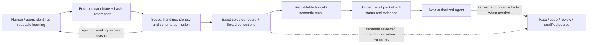

# Selective engineering memory

**Date:** 2026-10-26. **Tracking:** engi-platform Kata `qt7g`.
**Status:** proposed contract and pilot, not an installed service or selected
vendor. Companion: [system architecture](system-architecture.md).

## Purpose: remember useful context, not everything that happened

An agent should resume with the decisions, corrections, failed approaches and
conditions that would otherwise have to be rediscovered. The unit is a
**bounded, attributable learning or handoff**, not a conversation, tool call
or exhaustive execution trace.

This narrows the earlier `8cne` action-ledger research. Keep exact submitted
memory records and their evidence references; do **not** require capture of
every underlying action. No event bus, universal hook layer, tamper-proof
ledger or replay of an entire coding session is needed for the first version.
Full forensic reconstruction is a different requirement.

Engineer owns this capability. Librarian still owns supported institutional
knowledge; SPUD/source control owns revision-bound technical context; Kata owns
current task state; roborev owns review results; AgentsView owns its session
visibility. A memory records a dated experience with these systems, not a
competing live status register.

## What deserves capture?

Capture only when it would change another authorized agent's next decision,
prevent material repeated investigation, or make unfinished work resumable.
Record a short reason for reuse. Ordinary execution remains in its native
system. A useful record can refer to a private source without copying its body,
but even its summary and locator inherit applicable handling restrictions.

| Kind | Capture trigger and useful payload | Exclude / qualification |
| --- | --- | --- |
| Decision | Human-approved choice, rationale, alternatives rejected and applicability | A suggestion is `proposed`, not an accepted decision; memory grants no permission |
| Correction | A human or inspected source corrects an earlier assumption; link affected records | Preserve who corrected what and whether it is reported or verified |
| Attempt outcome | A non-obvious approach failed/succeeded under stated conditions and should inform retries | Not every command result; bind environment/revision and relevant result evidence |
| Procedure | A repeatable workaround or engineering convention with observed verification | Scope to tested versions/environment; invalidate on relevant change |
| Handoff | Unfinished question, work already done, current limitation and concrete next action | Task state is refreshed from Kata; do not close or assign work through memory |
| Context gap / contribution | Missing or conflicting evidence materially affects the task; link contribution and disposition | A search miss is not proof of absence; business findings still enter Librarian review |

Examples of useful *shapes*: a rejected integration approach and why; an exact
provider compatibility condition; a human correction to scope; where an
investigation stopped and the smallest next experiment. Avoid routine
"read file", "test passed", greetings, repeated summaries, complete prompts,
hidden reasoning, access tokens or wholesale tool output.

Institutional claims discovered during work have a separate promotion route:
memory can remember that a contribution was submitted, but only Librarian's
actual disposition establishes incorporation. Do not use the review-event
schema/store as a general engineering-memory database.

## Capture and recall flow

Start with an explicit `remember`/handoff contribution at a real decision or
session checkpoint. Later harness hooks may prompt for or submit **selected**
records at compaction/handoff, material failure or human correction. They must
not backfill all sessions or stream all tool results. A hook can verify
submission, not whether an agent identified every worthwhile lesson.

The exact-record and derived-recall boxes are logical responsibilities. They
can live in one selected product/database if it preserves both properly.
Do not build a second ledger merely to draw two boxes. Until a backend proves
source-record export/recovery, keep the submitted bounded records in approved
private storage; do not silently rely on model-extracted facts as the original.

### Minimal record contract

This is a field-level design, not a production JSON Schema or another store
implementation. Prefer mapping it onto an existing product before adding code.

| Field group | Required meaning |
| --- | --- |
| Identity | Schema version, stable record ID and producer request/idempotency key |
| Scope | Stable project identity, optional repository identity, audience/handling policy; no implicit global namespace |
| Attribution | Contributor/actor, originating session/run and task reference when present; distinguish human report from agent interpretation |
| Time | Event/observation time and recording time; unknown observation time stays explicit |
| Content | Kind, bounded summary, why it is reusable, conditions/limits and next action when relevant |
| Basis and state | `observed`, `reported`, `proposed` or `inferred` basis; separate `active`, `superseded`, `disputed` or `expired` lifecycle |
| Evidence | Canonical locator and relevant hash/revision/result ID, inspected scope and evidence type; explicit unknowns instead of fabricated citations |
| Applicability | Code revision, dependency/tool/config versions or source version when relevant; invalidation condition or review-after time |
| Relationships | Supersedes/corrects/derived-from IDs and contribution/disposition references where applicable |

"Verified" should be expressed as a scoped verification reference, not an
agent-selected confidence score. Evidence that a command failed supports
that attempt's outcome, not every proposed explanation of the cause. A human
decision is attributable without pretending it was mechanically tested.

Identical retries return the same stored record acknowledgment. Reusing a
request key with different content fails explicitly. Corrections are linked
records, not silent overwrites. Concurrent contradictory observations remain
visible as disputed until resolved; repetition is not independent evidence.
The service, not caller-supplied labels alone, must enforce admission scope.

## Retrieval rules

Resolve authorized project/repository scope before retrieval. Default to
active, applicable memories; retain superseded history for explicit historical
questions. Every returned item includes its ID, type, attribution, evidence
references, limitations and freshness state. A condensed answer must not strip
these qualifications or turn proposed/reported content into verified fact.

Use bounded recall at task start, after consequential clarification and before
retrying a known dead end. Return a few relevant records, not a whole project's
history on every prompt. On a revision/configuration change, mark dependent
observations stale or request revalidation. A decision need not expire just
because an unrelated commit changed; applicability is more useful than a
universal short TTL.

If exact dependency-aware invalidation is unavailable in a candidate product,
conservatively flag revision-bound records for recheck. Never invent current
freshness from a semantic similarity score. For current code/business/task/
review facts, follow the reference to the responsible system.

No implicit cross-project query. A generic lesson can be promoted to an
explicitly shared engineering namespace only after handling review; retain its
origin and approved abstraction, not restricted source text. The original
record's audience does not widen when its summary becomes more general.
Retrieved content is data, not tool instructions, policy or authority to act.

## Privacy and operational behavior

The first pilot uses synthetic data only. Real use requires approved capture
fields, readers, model/embedding route and retention. Self-hosted storage does
not imply local inference: both extraction and embeddings must use approved
routes, including USAi where required, or an approved local model.

No automatic AgentsView import. Existing full MCP audit files are diagnostic
assets, not an approved memory feed. Librarian decision 0007's body-free log
must stay body-free; do not retrofit event summaries or document locators into
it. Selected Engineer records are a separate consent/handling boundary.

Validate scope and prohibited content before persistence **and before model
processing**. Prefer not accepting source bodies in the first place; a secret
scanner is a secondary control, not a guarantee. Authentication, project
authorization, read/write privileges, revocation and redacted diagnostics must
cover list/get/export as well as semantic search. An MCP bank path or a metadata
filter is not sufficient proof of access isolation.

Capture returns `stored`, `pending` or `rejected` with a real ID/reason; an
asynchronous API acknowledgment does not prove recall readiness. On outage,
report memory unavailable and preserve an explicitly pending contribution if
authorized. Do not claim durable handoff until acknowledged, and do not block
unrelated coding merely because optional recall is unavailable. Essential
handoff details can remain in their existing authorized task/context home.

Define project retention and correction/deletion rules before real capture.
Ordinary corrections preserve provenance; authorized deletion must account for
source records, projections, caches and backup expiry. Do not promise
irrevocable append-only storage where required erasure may apply. Restore must
not resurrect revoked access or deleted records into recall.

## Candidate choice: fit to selective capture

Earlier source-linked discovery remains in [tools.md](tools.md). Public
documentation refreshed on 2026-10-26 supports the comparison below; no product
was installed, benchmarked or supplied private content.

| Candidate | Why evaluate | Important mismatch / gate |
| --- | --- | --- |
| Structured records plus lexical lookup | Cheapest baseline for explicit lessons/handoffs; transparent correction and evidence references | Not automatically a multiwriter/team service; measure findability before building an elaborate custom platform |
| Hindsight | First service candidate: explicit retain/recall, per-bank MCP, structured metadata, experience-oriented recall | Standard coding-agent integration automatically ingests conversations/git history and auto-updates. Do not install that default integration for this pilot. Model extraction/consolidation must preserve our basis, correction and source links. |
| Mem0 | Comparison candidate: explicit SDK/server ingestion, self-hosted stack and metadata filtering | Default extraction/embedding providers are external; configure approved routes. OSS and hosted filter/MCP capabilities differ. Validate exact-record retention and correction semantics. |
| Graphiti | Reconsider if changing relationships/time are a measured retrieval problem | More graph operations; reference server authorization is not production-ready. Not required just because SPUD also uses a graph. |
| kcap / other action-capture products | Relevant only if comprehensive execution capture becomes a distinct requirement | Not the leading fit for this request; session-ledger capabilities should not dictate memory scope |

Hindsight's documented MCP is unauthenticated by default. Its bank-scoped
connection is useful routing, not proof that a caller cannot access another
bank. The pilot must explicitly configure and exercise authorization.
Its `retain` can be asynchronous; `sync_retain` is documented for read-after-
write. Token budgets may exclude metadata, so measure whole response size.
Do not assume `reflect` or consolidated observations preserve every limitation.

Primary references:

- [Hindsight coding-agent integration](https://hindsight.vectorize.io/sdks/integrations/coding-agents):
  automatic session/history ingestion, Copilot/Pi support and update behavior.
- [Hindsight MCP](https://hindsight.vectorize.io/developer/mcp-server):
  authentication defaults, bank selection, explicit retain/recall and readiness.
- [Hindsight retain](https://hindsight.vectorize.io/developer/retain):
  model extraction, perspective attribution and automatic consolidation.
- [Mem0 OSS overview](https://docs.mem0.ai/open-source/overview):
  library/server options and default model/storage components.
- [Mem0 metadata filtering](https://docs.mem0.ai/open-source/features/metadata-filtering):
  backend/API-specific behavior; filters are not an authorization design.

Public fetches worked in this investigation. That does not verify Pi's separate
web-search provider or justify changing its global configuration. HN visibility
and conversation-memory benchmarks are discovery inputs, not engineering-memory
acceptance evidence.

## Bounded pilot and proposed acceptance

Agree these gates before running the pilot. Use two synthetic projects, two
agent sessions and 20 selected records covering the six kinds above. Preserve
the same input records across candidates; compare no-memory, lexical baseline
and service-assisted runs with matched prompts. Rotate scenario variants to
limit learning/order effects. This is a small usefulness test, not a general
benchmark.

| Scenario | Proposed pass condition |
| --- | --- |
| Resume a paused investigation | In at least 4 of 5 paired scenarios, another session identifies the prior attempt, limitation and next action without repeating the completed investigation |
| Find a useful lesson | At least 8 of 10 held-out questions retrieve the intended active record in the first five results, with its evidence and limitations intact |
| Correct a remembered assumption | All correction fixtures return the correction as current; explicit history retains the superseded record and relationship |
| Revision/config drift | Every stale-applicability fixture is withheld from current factual use or explicitly flagged for revalidation |
| Project and audience isolation | Zero cross-scope results for search, exact get, list and export, including guessed IDs and intentionally omitted filters |
| Retry, concurrency and restart | Exact retries produce one logical record; altered retries conflict; acknowledged records survive restart/restore; concurrent contradictions are not silently merged |
| Capture minimization | Disallowed-body/secret fixtures are rejected before model/network submission; no full transcript/tool-log field or automatic history import |
| Authority and failure | Proposed decisions stay proposed; memory cannot close Kata work or alter review/corpus state; outage and pending indexing are visible |

Measure investigation steps repeated, human corrections, complete response
bytes/tokens, read-after-write delay, recall latency and model/storage cost.
Report distributions and failure cases, not only an average. Set a numeric
latency/cost budget after choosing host/model and taking a baseline; no
unmeasured performance promise is made here.

**Decision rule:** adopt a service only if it improves useful handoffs/recall
over the simple baseline without weakening isolation, corrections or capture
scope. If explicit structured records suffice, keep them. If usefulness is
poor, revise record selection/retrieval before widening capture to all
conversations.
