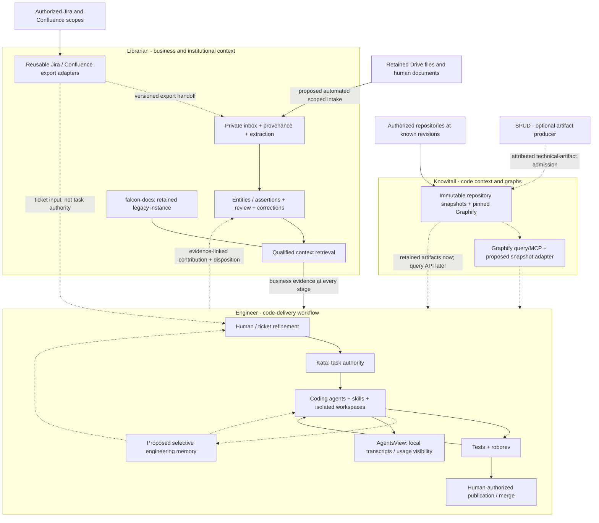
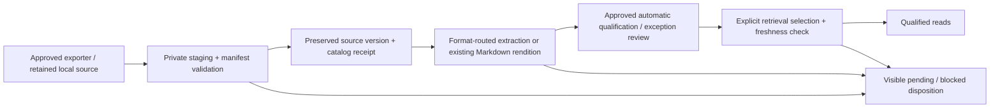
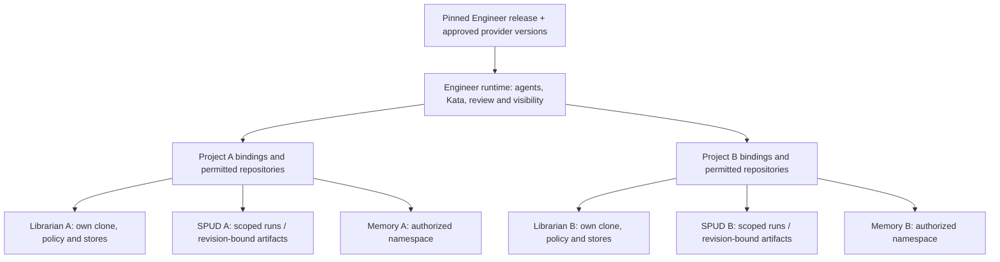

# Engineer, Librarian and SPUD: ownership and reproduction

**Date:** 2026-10-27. **Tracking:** engi-platform Katas `qt7g`, `rmgx`, `pd40`, `c6by`.
**Status:** architecture proposal grounded in local inspection, not an installed
integration or authority to rename, migrate, deploy or change SPUD.

**Activation, 2026-10-26 18:28 (`txt3`):** the owner authorizes reconciliation,
the first bounded Engineer implementation/pilot and Hindsight configuration
preparation. Other proposed integrations remain gated; REA is deferred.

## Design-document map and planning boundaries

Keep this as the single cross-product architecture: product ownership,
observed-versus-proposed capability, integration boundaries, sequencing and
unresolved decisions. The focused documents and task authorities are:

| Concern | Canonical home |
| --- | --- |
| Engineer coding/review workflow | [engineering-workflow.md](engineering-workflow.md) |
| Selective engineering memory and Hindsight evaluation | [engineering-memory.md](engineering-memory.md) |
| Code-context product, repository intake and graph reuse | `the_knowitall/README.md`; owning native project `knowitall` |
| Producer/receiver protocol details | Producer-owned SPUD evidence and Librarian toolkit receiver design, linked from native Kata |
| FALCON source corpus, provenance, handling and qualified retrieval | FALCON's own canonical corpus records and stores; do not copy them into Engineer |
| Current execution, owners, dependencies and completion evidence | Native Kata issues in the owning projects; this architecture links to them but is not a second task ledger |

Keep proposals and unknowns explicit here until a decision is made; put an
accepted component contract in that component's own documentation and link to
it rather than maintaining competing copies. Use dated decision entries for
changes in direction, and do not turn a proposed sequence into task status or
authorization.

## Remaining demo integration gaps: 2026-10-27, pre-refinement

The current component backlog is substantially covered; do not add another
parser, queue, graph engine, memory-research task or replacement UI. Comparing
the current native acceptance bodies with the unchanged code baseline exposes
three cross-product concerns before parallel implementation:

1. **Business-to-code link lifecycle ownership is underspecified.** `pwhw`
   defines external code references, `xzkj` implements business relationships,
   and `k4mp` consumes a connected evidence trace. Explicitly assign creating,
   qualifying, retaining and invalidating the cross-product assertion when
   either document or code revision changes. Prefer a bounded Librarian-owned
   implementation slice or deliberate expansion of `xzkj`, not an Engineer
   shadow graph. Candidate matches, ambiguous links and confirmed assertions
   need different states; names alone cannot establish implementation.
2. **No shared known-answer contract fixture / integrated demo harness is
   explicitly owned.** Provider contracts and component tests are planned,
   but their combination needs one versioned scenario and expected answers.
   Exercise real adapters/providers, source-to-symbol evidence, a changed source,
   interrupted intake/replay, and explicit missing evidence. Include
   counterexamples such as same-name entities and an unsupported/contradictory
   claim. Keep synthetic fixtures temporary and business data out of reusable
   product initialization; real-data demonstration remains a separate approved
   acceptance. This can be an Engineer child of `pyzt`.
3. **Knowitall development onboarding is conditional work.** Git and native
   Kata binding exist; no remote/provider registration or Forge mapping was
   created. If Forge runs this repo's implementation agents, select and prove
   the supported repository/worktree/agent route. A CLI-only local worktree
   workflow can avoid making private remote publication a prerequisite. Do not
   confuse code-source intake (`7gv8`) with development-repository onboarding.

Refine existing acceptance rather than create more infrastructure:
`pyzt` should name the approved demo cohort/change and a read-only evidence
walkthrough showing passage -> business assertion -> code/dependency ->
change/review, including completion/DLQ limitations. A CLI/static report is
sufficient; do not resurrect the retired Falcon visualization project.
`k4mp`/`6hce` should explicitly prove real provider binding/discovery, not just
well-shaped mocked packets. `pbqn`/`zbww` should supply a two-session memory
reuse/correction scene; archive visibility is not memory usefulness.

Project/material/model approval, known hardening findings, connector recovery,
graph incrementality and deployment choices already have owners. These are
open gates, not newly discovered features. This audit records proposals only:
no new Katas, changed dependencies or implementation agents were launched.

## Approved product split and filed backlog: 2026-10-27 (c6by)

The owner now establishes **The Knowitall as the code-context repository/graph**,
**The Librarian as the business-context repository/corpus**, and **The Engineer
as task/agent/review/visibility/memory orchestration and consumer of both**.
This explicitly supersedes the earlier recommendation not to create another
top-level project and the assumption that SPUD remains our code-context owner.
SPUD remains independently maintained reuse/source evidence, not a required
universal pipeline or fourth product in the target demonstration.

Initialized local `the_knowitall` with Git and native project `knowitall`.
Its README captures source findings, component reuse rather than blind code
copying, immutable repository intake, graph provenance/query/publication,
business-entity intentions and cross-product links. No remote, source corpus,
graph runtime or code assets were created by the bootstrap.

The prior shortlist is now native planned work, not an unfiled proposal:

| Owning project | Created / reused native work |
| --- | --- |
| Engineer | `pbqn` selected agent-event memory; `k4mp` Librarian/Knowitall evidence composition. Reuse `zbww` evaluation (now P1), completed `svg1` preparation and `f47m` provider code. |
| Knowitall | `7gv8` repository intake; `r9gz` pinned Graphify; `8jvw` code queries; `regc` resumable updates/publication; `axsf` optional SPUD artifact import. Existing provider contract moved intact from `spud#vky6` to `knowitall#vky6`. |
| Librarian | `zqdh` Docling reads; `1md4` durable jobs/DLQ; `rst9` export import; `bj17` Confluence; `5bc5` Jira; `3sx1` Drive; `9hqs` manual upload; `8a5h` ordinary text; `0nj8` policy publication; `rjr5` contribution transport. |
| Librarian entity model | `pwhw` engineering-oriented business entities/claims/relationships; `xzkj` first source-backed implementation slice, genuinely blocked by that design. |
| Existing receiving/reuse design | `spud#3sv9 -> librarian#55nx` remains; useful OKF acceptance was added to `55nx`, not duplicated as another design or mandatory HTML pipeline. |

Nineteen new tasks are unowned/planned with explicit acceptance and real
prerequisites. Existing hardening/parity tasks remain. No implementation
worker, real repo/document ingestion, inference or source migration follows
from task creation. Empty Librarian corpus is an opportunity to design useful
business context cleanly, not permission to reset populated authority stores.
Source passages, stable entity identity, aliases, evidence-backed assertions,
conflicts/corrections and temporal applicability precede derived traversal;
code symbols remain external Knowitall snapshot references.

The AgentsView repair is separate live configuration work authorized by this
request. Existing `3c2c` records the repaired conversation slice; its broader
pricing/retention/client acceptance remains open. See status/tools for exact
body-free verification and private rollback evidence.

## Implementation-only backlog audit: 2026-10-27 (e5dd)

Historical audit snapshot: its proposal-only status and SPUD ownership wording
are superseded by the approved split and filed native tasks above.

The owner requests only work not already implemented or underway, with
operational agentic memory a priority and missing AgentsView conversations
investigated. Three independent read-only audits covered Librarian, Engineer,
and SPUD/core Web/dependencies. Native history was reconciled separately:
before this audit, Engineer had 27 open/49 closed tasks, Librarian 3 open/8
closed, and SPUD 2 open. An open task is not evidence that its implementation
is missing; a roadmap entry or closed design task is not a shipped runtime.

### Do not propose these delivered capabilities again

| Delivered or already worked | Existing evidence / limit |
| --- | --- |
| Kata, Forge agents/workspaces, roborev and AgentsView ingestion | Existing services and completed bounded coding/review pilot `jgcf`; retain separate unresolved acceptance tasks, not replacement components |
| Explicit Librarian executable/reader/root/selection setup | Completed `f47m`, preserved commit `dae66cd` and review 104; intentionally unmerged, not an absent implementation to redo |
| Memory research and disabled Hindsight preparation | `8cne` and `svg1` complete; reuse unexecuted evaluation `zbww`, not another research/configuration task |
| Catalog/review authority, idempotent writers, explicit selection and atomic index build | Existing Librarian implementations; automation should call them rather than create parallel authorities |
| PDF/image Docling prepare/verify/register | Completed `k6pr` and its worker/lifecycle/clean-copy children; native-text PDF is included, not a missing PDF adapter |
| Contribution/disposition and producer/receiver design | `djfr` contract complete; `spud#3sv9 -> librarian#55nx` and `spud#vky6` already own design work |
| Librarian hardening and graph/edge design | `q9a9` owns existing findings; `7bna` owns parity; decision 0006 has current design edits. Do not duplicate these as untouched work. |

### Unworked implementation shortlist, not newly filed records

Labels below are proposal keys, not native issue IDs, except where an existing
task is explicitly reused. Each is an unimplemented runtime slice or unresolved
operational scope. Existing design/acceptance tasks retain their identities.
This audit does not activate implementation, source acquisition, transcript
retention or model processing.

| Owning project / proposal | Bounded outcome and acceptance | Reuse / dependency |
| --- | --- | --- |
| Engineer E-MEM: selected-event memory runtime | Admit authorized compact agent events/lessons/handoffs, acknowledge durable records, recall across sessions, deduplicate exact retries, link corrections and reject cross-project access. Report unavailable/pending states; no implicit full-transcript capture or duplicate task ledger. | Existing memory contract and `svg1`; use `zbww` to qualify the backend. Memory is now a requested priority, not a reason to block unrelated intake work. |
| Engineer: reuse `3c2c` for conversation visibility | Add the concrete current policy/filter mismatch to its existing retention/client-coverage scope. Restore intended visibility using supported configuration under approved retention/backfill scope; distinguish unavailable history from import failure. Add diagnostics only if needed. | Existing AgentsView integration and `3c2c`, not another importer or duplicate retention task; preserve `fjyf` no-session accounting scope |
| Engineer E-CTX: task-scoped business/code evidence composition | Consume both providers, retain exact document locators/version and code snapshot identity, expose partial/stale/missing evidence, and bind the returned evidence to the task. Reuse acknowledged contribution delivery rather than writing corpus state. | `f47m` implementation, `spud#vky6` provider contract, `pyzt`; `6hce` remains actual qualified-read acceptance |
| Librarian L-READ: selected Docling rendition retrieval | Extend rendition admission/read support to registered Docling outputs, preserving page/table provenance, limitations, source/policy freshness and exact qualified packets. Do not redo conversion or auto-select every rendition. | Existing Docling lifecycle, selection and reader; agree eligible rendition policy |
| Librarian L-JOBS: durable intake stages and DLQ | Persist stage work and saved requests, resume interrupted operations, retry transient failures, inspect/replay dead letters, and keep failed scope visible. Verify ambiguous commits without duplicate authority writes. | Existing catalog/review idempotence and Docling retry artifacts; no new authority store |
| Librarian L-EXPORT: retained-export importer | Validate the approved supplied-export layout, retain originals, map metadata and submit exact receipts; refuse changed/conflicting/incomplete retry inputs. | Implement after existing `55nx` design and `spud#3sv9` evidence; no crawler in this slice |
| Librarian L-CONF: Confluence reconciliation adapter | Use the standalone exporter with complete initial-sweep accounting, independent failed-page/attachment retries, safe committed watermarks and explicit changed/deleted/revoked outcomes. | L-JOBS/L-EXPORT and corrected exporter behavior; do not rebuild its renderer/API client |
| Librarian L-DRIVE: Drive reconciliation adapter | Discover the approved scope, retain native exports/binaries with stable identity/version, resume pagination/change processing, and account for shortcuts, shared drives, removals and permission loss. | Common receipt/recovery contract; Graphify shortcut export is not this connector |
| Librarian L-TEXT: ordinary UTF-8 text extraction | Add exact line-located generic text through the existing lifecycle; refuse unsupported encoding rather than misclassifying all text as Gemini transcripts. | Existing extraction/registration contracts; no new PDF/OCR task |
| Librarian L-PUBLISH: standing-policy processing/publication runner | Orchestrate actual authorized review and explainable eligibility decisions, then existing explicit selection/atomic index publication. Preserve uncertainty, exceptions and failed-publication state; parsing is not review. | Existing writers/builds and agreed project policy; L-READ for Docling content, L-JOBS for recovery |
| Librarian L-CONTRIB: durable contribution/disposition transport | Preserve submitted bytes/correlation, return actual receipt and disposition, reject conflicting retries, and recover interrupted returns. Supply a thin Engineer submit/status route, not another write-capable retrieval MCP. | Completed `djfr`/`agents/contributions.md` contract, catalog writer and L-JOBS |

Office formats and larger-than-limit inputs are genuine remaining gaps, but
should become separate DOCX/XLSX/PPTX or bounded-large-document implementation
Katas after prioritizing the actual cohort and checking `7bna` reuse evidence.
Do not roll them into "add Docling" or claim all DOC/PDF formats are covered.
Likewise, typed business entities/claims and a derived relationship runtime
are absent, but their admission/authority design is already being worked on.
Implement the selected real-query slice after that decision rather than
creating another graph-design task or a speculative graph database project.

### Current visibility and memory findings

AgentsView's saved configuration and tracking metadata both select `usage`
archive content. Read-only aggregates found 17,665 message rows with zero
nonempty bodies; source code deliberately strips bodies in this mode. Default
filters also exclude some one-shot/automated sessions. Configured Copilot/Pi
source files are readable and service/build identity matches. This supports a
policy/filter explanation, not a missing integration or wholesale importer
failure. No conversation bodies were read, and no capture policy was changed.

AgentsView also contains experimental transcript-derived Recall; that is not
the selective-record Engineer memory runtime and is refused in usage-only mode.
Hindsight remains prepared, not running/configured for use. Reuse existing
contracts and evaluation rather than mistaking either product's presence for
durable selected-memory admission and retrieval.

### Final SPUD choice from the current source

Prefer **external composition plus bounded upstream fixes**, not a SPUD
rewrite or a new extraction platform. The standalone Atlassian exporters,
Graphify and Docling already exist independently; there is normally no SPUD
code to extract merely to use them. Keep SPUD's documentation generation and
code artifacts where valuable, and consume them through an acceptance adapter.
If SPUD does not produce the technical evidence, label that alternative
honestly rather than calling Graphify-only execution a three-product demo.

SPUD already provides repository analysis, graph artifacts, raw/Markdown
exporters, job queues and terminal-event DLQ handling. That DLQ recovers
execution/deployment events, not missing document pages/attachments; its
citation-review queue has another scope again. Graphify already stamps commit
provenance and supports typed edges, source locations, queries/MCP and
incremental processing. Do not spec these as missing engines.

Bounded maintainer-facing fixes include dispatch-error propagation, required
persistence failures, incomplete-run watermark/item retry semantics, version
pinning and preventing incomplete review from becoming `stable`. Building
Drive discovery, a durable per-item lifecycle/DLQ and controlled qualification/
publication inside SPUD would change its product remit, not merely steer a
small implementation. Those missing capabilities belong in Librarian.

Existing provenance must also be connected, not reinvented: Web captures clone
SHA and skipped-upload information, but source uploads omit `.git`, tolerate
some missing files, and may lose their manifest; SPUD independently permits
unknown Git provenance. An acceptance adapter needs persisted artifacts plus
bound coverage/revision evidence. A wrapper cannot infer complete source
coverage from successful files alone; exporter reconciliation/fixes are still
required. Existing upstream completed stories are not untouched specs.

Pins, file/line evidence, validation limits and maintained native references
are recorded in `context/tools.md`. No product implementation or existing
acceptance task was represented as completed by this audit.

## FALCON legacy-technology boundary: 2026-10-27

The owner freezes further functional development of `falcon-docs`, not its
useful operation or information. Preserve its existing MCP server and document
ingestion pipeline for authorized use, along with original bytes, provenance,
restrictions, catalog/review authority and history. Retaining those capabilities
does not certify their present freshness or authorize a new ingestion run.

Further FALCON hosting, unattended-ingestion and compatibility-cleanup work is
retired; `falcon-docs#5njc`, `#51kq` and `#939r` remain closed as `wontfix`.
The FALCON graph-visualization workstream `engi-platform#vmhy` and its five
remaining children are also retired as `wontfix`, not accepted as complete.
Preserve the completed contract and existing graph assets; do not silently
move this feature backlog into the reusable toolkit.

The eventual destination is `the_librarian`, but **first harden and validate
the toolkit against a different owner-approved project** (`librarian#q9a9`).
The Acquire recommendation below does not by itself select or authorize
business-document materials for that validation. Preserve read-only legacy
parity inventory under `librarian#7bna`; inventory is not migration approval.
After the hardening gate, separately agree identity/version mapping, provenance
and handling preservation, validation, recovery and cutover before transfer
or re-ingestion. Do not remove the checkout, stop services, mutate stores,
refresh the index or change handling policy as backlog cleanup.

### Keep the remaining work with its owner

| Boundary | Retain | Retire or defer |
| --- | --- | --- |
| Engineer | Refinement, task authority, coding/review workflow, provider-use acceptance, visibility and selective engineering memory | Retire the Falcon-only visualization workstream. Old rename target `5ayh` is superseded by deferred Engineer migration `eb48`; no rename is performed. |
| Librarian toolkit | Independent-project hardening, qualified business context, intake/receiver design and read-only legacy parity evidence | Falcon migration follows the hardening gate and a separate approved plan. Unresolved toolkit findings are not obsolete because Falcon is legacy. |
| SPUD | Revision-bound code context and producer/exporter evidence within its own implementation boundary | Do not move acquisition ownership into Engineer or treat an assessment as an executed pipeline. |
| FALCON legacy instance | Existing MCP, document ingestion, corpus, provenance and history | No further functional development, hosting expansion or new graph pilot. No teardown or corpus deletion. |

Review cleanup preserves original verdicts and findings. Passing reviews,
verified corrections, duplicates with an open keeper, and intentional
diagnostic-fixture failures can leave the actionable queue with an explicit
disposition. Distinct unresolved defects remain open; see native cleanup
`engi-platform#pd40` and hardening `librarian#q9a9`. Application maintenance is
not retired by a decision about `falcon-docs`.

Cross-product Jira/Confluence handoff design now has one Engineer coordinator,
`engi-platform#dh1t`, with the producer evidence task `spud#3sv9` and receiver
contract task `librarian#55nx` as children. The existing producer-before-
receiver dependency remains. Engineer coordinates only; SPUD owns exporter
behavior and Librarian owns receiving, provenance and qualification. This
work remains design/local-evidence only, not a source-pipeline run, unattended
ingestion or corpus change.

## Engineer current milestone and queue: 2026-10-27 (wvd2)

Focus current Engineer work on **one connected three-product demonstration**,
coordinated by `engi-platform#pyzt`. The original 31-item backlog mixed that
goal with personal tooling, optional host experiments and later distribution
work. The owner explicitly retired dictation, additional Zed attachment,
mirrored networking, renewal-interface research and the unreproduced shell
report as `wontfix`. Existing tools and historical evidence are preserved.

The immediate Engineer portfolio has six P1 items under `architecture-now`:

| Work | Existing authority |
| --- | --- |
| Coordinate document evidence -> business rule -> code/dependency -> approved change/review | `pyzt` |
| Verify loaded operating policy, then failing/successful behavioral and publication gates | `k03a -> mpew` |
| Demonstrate an actual model-selected qualified read, not only tool discovery | `6hce` |
| Preserve task ownership and truthful attention through interruption/resume | `tvbf` |
| Coordinate SPUD export evidence and Librarian receiving contracts | `dh1t`, retaining `spud#3sv9 -> librarian#55nx` |

Knowitall now owns the code-context provider-contract design `knowitall#vky6`,
moved with identity/history intact as a child of the connected milestone.
Librarian retains independent-project
hardening `librarian#q9a9` and its own admission/qualification/intake work.
Do not turn Engineer coordination into ownership of either provider's engine.
The provider design and receiver contract do not themselves implement the
unattended Confluence/Drive lifecycle; agree bounded owning-project work
before implementation.

Twenty-one Engineer items remain open under `architecture-later`: six P2
supporting workflow/documentation checks and fifteen P3 expansion/operations
items. Hindsight, bespoke review UI, media capture, cloud hosting, renaming
and complete fresh-host distribution are not prerequisites for this milestone.
Later priority never waives applicable access, recovery or sandboxing rules.
Current native task records own the detailed list and completion evidence.

Use `kata list --label architecture-now` or
`kata next --label architecture-now` through the repository binding. A ready
Kata means no unmet task prerequisite, not authorized source/model execution.
Agree the independent project/material and processing scope before running
the connected demo; Acquire code permission does not authorize business
documents. Existing policy and producer-before-receiver prerequisites remain.

## Post-onboarding recommendation: 2026-10-26 (kamh)

**Superseded for the expanded demo by the October 27 assessment below.**
The bounded Engineer pilot remains useful prior evidence, not the whole demo.

Private GSA repositories, Forge catalog entries and explicit Kata mappings now
exist for Engineer, Librarian toolkit and SPUD (`7943`). Toolkit/corpus task
separation is also delivered; Falcon remains local and unmapped. This removes
the onboarding blocker, not the need to demonstrate a real engineering loop.
The toolkit distribution remains data-empty.

The next milestone should be **one useful, bounded task through Engineer**,
with interface checks exercised along the way, plus the existing SPUD export
contract investigation. Do not wait for every cleanup item, a new context
service or Drive support before using the platform. This recommendation updates
the delivery order below; it does not activate implementation or unattended
ingestion. Existing native Katas remain the work authority.

## The correction to the previous plan

Keep three product boundaries, but separate **who acquires material** from
**who maintains its meaning and evidence**. SPUD already provides useful
Jira/Confluence acquisition. Librarian should consume those exports, not wait
for replacement connectors before becoming useful at scale. Engineer owns the
code-delivery workflow and selective engineering memory, not every source store.

The missing link is a reliable **export-to-inbox-to-qualified-context handoff**.
Faster downloading alone does not supply source versioning, review, corrections
or retrieval freshness. Conversely, strict qualification alone does not solve
slow, manual ingestion. Both capabilities are needed.

The prior conversation is preserved unchanged, privately, at
`.local/context-inputs/tmp_convo.txt`. This proposal revises its delivery order:
acquisition integration and repeatable project setup move earlier; a new SPUD
query service and a full action ledger are not prerequisites.

## SPUD fit and the three-part Acquire demo: 2026-10-27 (rmgx)

**Maintainer boundary clarification:** the owner notes that rearranging SPUD
may conflict with its original engineer's direction. The recommendation below
is not an agreed SPUD redesign. Prefer a producer/consumer contract over
changes to its internals: consume its existing graph/artifact outputs through
a small adapter where sufficient, and discuss additional capabilities under
`spud#vky6`. Independently using Graphify would be a separate technical
provider, not evidence that SPUD itself participated in the demo.

**Recommendation, not implementation approval:** adapt and compose; do not
rewrite SPUD wholesale or treat its current pipeline as a complete knowledge
platform. The owner requires all three products to demonstrate value together.
Acquire is the viable code-backed candidate because its code may be downloaded;
FALCON code may not. Document access and permitted processing destinations still
need their own scope. No project code or documents were acquired in this assessment.

### What is reusable, and where it belongs

| Component inspected | Fit | Recommendation |
| --- | --- | --- |
| Graphify (`graphifyy`) | Real code graph, typed relationships, source locations, incremental processing, bounded query/path operations and MCP; not just a diagram generator | Pin and call its deterministic code-only CLI directly within the SPUD code-context boundary. Add a thin project/revision/coverage contract, not another graph engine. Evaluate representative Acquire languages before committing to it. |
| SPUD core | Agent-driven technical-documentation factory around Graphify; local/cloud export wrappers and OKF/site packaging | Keep narrative generation as an optional graph consumer. Decouple graph availability and machine intake from long agent-documentation and HTML/ZIP runs. |
| Standalone Jira/Confluence exporters | Existing separate projects retaining raw JSON, Markdown, attachments and state | Reuse and harden upstream or through an approved maintained dependency. There is no need to extract these from SPUD first. |
| SPUD Web | Existing job UI/API, DynamoDB locks, queues, Streams dispatch, Step Functions and terminal-event handling | Reuse for run visibility if helpful, after correcting failure semantics. Job-level orchestration is not a per-source-item completion ledger. Do not rebuild it merely because the earlier assessment missed it. |
| Librarian intake and knowledge layer | Missing durable automated acquisition-to-retrieval lifecycle; no Acquire instance established | Build the common intake/reconciliation worker and Drive adapter here, using existing supported stores/writers. Business entities, conflicts, citations and automatic qualification policy remain Librarian responsibilities. |

The choice is **reuse Graphify, harden exporters, build missing Librarian
intake**, with SPUD/Web retained where useful. A new top-level project is not
justified yet. Extract a small neutral connector package only if independent
consumers need it; use existing exporter packages first. Graphify carries
license files; no LICENSE/NOTICE files were found in the pinned exporter trees.
Confirm upstream maintenance and reuse rights before copying or redistributing
code; repository availability is not a substitute for that check.

### Why the current ingestion is not "set and forget"

These findings distinguish source inspection from synthetic reproduction:

| Evidence | Consequence |
| --- | --- |
| Confluence `cli.py:494-700` selects from the previous `last_run_start`, advances that marker during a run and catches page failures. A fake failed page reproduced exit 0, status `error`, and a newer marker; the next incremental call does not separately retry that old failed page. | An interruption/limit/partial historical crawl can strand old unvisited or failed pages outside the next modified-since query. A clean process exit is not coverage. |
| Jira `exporter.py:245-300` catches listing failures and saves `last_run` regardless. A fake first-page API failure reproduced normal return with `last_run` and `last_full_export` populated but zero issues. | Even unsuccessful discovery can look like a completed export and advance the incremental baseline. |
| Confluence attachment failure reproduced parent status `done` with an attachment marked `download_error`; unchanged-page handling skips work. | Page freshness does not establish attachment completeness or guaranteed retry. |
| SPUD cloud exporter EXIT handlers warn on failed S3 persistence without changing the original successful exit status. Web `_start_jira_execution` / `_start_confluence_execution` catch dispatch errors and construct an ARN; their caller records `RUNNING`. | Persistence/dispatch failure can have success-shaped tracking. These paths were traced, not exercised against AWS. |
| SPUD step 1 prompts an agent to run Graphify; required-output checks are existence/nonempty checks. Graphify is installed unpinned at container startup. | Artifact existence does not prove the expected revision, coverage or graph validity; repeatability depends on a moving external runtime. |

The graph situation is materially better than the earlier conversation implied.
SPUD's flat citation index discards edges, but Graphify's underlying graph has
them. Current Graphify also has partial-extraction safeguards, file manifests,
deletion reconciliation and an MCP build-commit staleness signal. Reuse those
instead of pretending they are absent. They still need a project-scoped
publication contract, especially for dirty worktrees and extraction exclusions.
The current upstream version inspected is not proof of the version deployed in SPUD.

Neither inspected SPUD nor SPUD Web implements Drive enumeration/change
reconciliation. Graphify's Google Workspace helper exports known shortcut files;
it is not a connector that discovers all authorized Drive documents. Jira's
search-payload comments also need pagination-completeness acceptance; a requested
`comment` field alone does not prove all comments were returned.

### Minimum implementation sequence and ownership

1. **Prove the code-context component on authorized Acquire code.** Pin Graphify;
   build without an LLM first; query a known dependency/call path with file/line
   evidence. Record repository identity, commit plus dirty-content identity,
   extractor version, included/excluded/failed files and graph artifact hashes.
   Publish a snapshot only after validation; make partial/stale scope explicit.
   Add language-specific extraction only if measured gaps justify it.
2. **Build Librarian's unattended intake spine and one Confluence vertical slice.**
   Maintain durable discovery progress and per-source/version/representation
   work items, raw artifacts, extraction receipts and retrieval publication.
   A worker resumes after interruption, retries bounded transient failures and
   exposes permanent failures; an operator must not manually restart each page.
   Harden exporter checkpoint/error handling rather than merely wrapping its
   successful exit. Keep scheduling separate from demonstrated recovery.
3. **Add Drive to the same lifecycle and expand to the whole approved scope.**
   Include shared drives, folder/shortcut traversal, native export formats,
   attachments where applicable, pagination, change tokens, identity/version
   mapping, permission changes and deletion reconciliation. A bounded pilot
   proves mechanics; it is not a permanent ticket-sized corpus restriction.
   Confluence and Drive acquisition do not wait for FALCON migration.
4. **Connect and visibly demonstrate all three.** Librarian derives a cited
   requirement/business-rule relationship; the SPUD graph supplies its candidate
   implementing symbols and downstream dependencies; Engineer traces both,
   proposes and performs one approved change, and shows its review evidence.
   Store cross-domain links as evidence-bearing assertions referencing both
   snapshot identities. Distinguish verified links from inferred candidates;
   name similarity must not silently become business truth. A local composed
   view is sufficient; a new graph database or platform UI is not required.

For the demo, show the path **document passage -> business rule -> code symbol
-> affected dependency -> Engineer change/review**, not three disconnected
screens or only a finished Markdown site. Also show a recovered interruption
and a changed/deleted source item without duplicate evidence or false freshness.
Hindsight remains Engineer-owned and is not a prerequisite.

### Completion and automatic qualification contract

"Set and forget" means convergent, observable automation, not guaranteed success
against permanently inaccessible sources. Define completion for a bounded
authorized scope and source watermark. Separate discovery cursors from the
last reconciled successful watermark; never replace the latter with a run's
start time before historical coverage is established. Persist work before
acknowledging it, retry independently of updated-since listings, and reconcile
deletions only after a complete listing or authoritative change event.

Report `complete`, `complete_with_exclusions`, `partial` or `blocked`, with
discovered/acquired/extracted/qualified/published counts and explicit reasons.
Only policy-approved exclusions may count toward terminal accounted coverage;
permission failures and unsupported formats are not silently successful.
Acquisition completion and retrieval readiness are separate statuses.

Approve an automatic extraction/qualification/selection policy once per project
and content class, with recorded policy/model versions, provenance and confidence.
Use manual review for exceptions/conflicts, not every document. Do not silently
relabel machine-processed evidence as human-reviewed. Existing Librarian gates
must be deliberately adapted; faster downloads alone cannot bypass them.
Permissions, approved model destination, retention and budgets are activation
inputs, not reasons to force manual per-document intake.

### Evidence scope and remaining unknowns

Source pins: SPUD `c80837a`, SPUD Web `8e9626d`, Confluence exporter v0.2.4
`b310442e22b9501c2527fa344ef272185e427e50`, Jira exporter v0.3.4
`7894cba1de887452667d1e54594df13f878e1686`, Graphify-Labs/graphify v8
`dac063456bc1f5d92354ec3936fd9dd1513a83f3` (package 0.9.96).
Important code: SPUD `services/steps.py`, `pipeline_runner.py`,
`index_service.py`, `docker/entrypoint.d/01-graphify.sh`, exporter entrypoints;
Web `services/execution_orchestrator.py:165-288,526-623`;
Graphify `cli.py`, `serve.py`, `google_workspace.py`.

Offline Python/TypeScript extraction, shared query-direction logic, incremental
updates and edge/file deletion checks passed. Three fake-client probes reproduced
the exporter gaps above. Exact validation limits and session-artifact locations
are in [tools.md](tools.md). No full cloud run, MCP transport acceptance,
Acquire language/scale benchmark, document semantic-quality/cost evaluation or
deployment is established. Keep `dh1t`, `spud#3sv9` and `librarian#55nx` open;
this assessment is not their producer/receiver acceptance.

## Text-first ingestion and a DLQ: October 27 follow-up proposal

The owner's "unstaple" proposal is a normalized, searchable rendition for each
authorized document, not destructive replacement of originals or conversion
of everything to a single unstructured text blob. Keep original bytes and
native structure alongside text/Markdown and structured locator metadata.
Prefer existing native text/HTML/Markdown; use PDF layout/OCR where needed.
Preserve tables, heading hierarchy, page/slide/sheet locations and image-only
scope. Empty or implausible extraction is a quality failure, not a complete
document; text alone cannot preserve every diagram or spreadsheet meaning.

Proposed flow: discover -> acquire/register original -> format-routed extraction
-> fidelity checks -> attributed knowledge processing -> qualified retrieval
publication. Every stage has durable work identity and retry state. Retry
transient errors with backoff; put exhausted/permanent item failures in a
dead-letter queue with source/version, stage, attempts, error and replay pointer.
Keep document bodies out of diagnostic messages. One bad item must not stop
unrelated work. Connector-wide credential/access failures should pause that
connector, not create an endless stream of failed-item jobs.

A DLQ is an operational disposition, not deletion, successful ingestion or
approved exclusion. Replays re-check authorization and current source identity,
preserve failure history and reuse exact committed requests where appropriate.
Human policy/ambiguity decisions belong in a separate exception-review state.
A private durable jobs table can supply the initial DLQ; a broker is optional,
and neither replaces the catalog/review authorities.

Current toolkit evidence: its roadmap already proposes standing-policy
automation and a durable operational journal; these are not implemented.
Its delivered Docling lifecycle handles PDF/PNG/JPEG with prepare/verify/
register, page provenance and bounded offline workers, but deliberately does
not advance intake, review, select or index. Current PDF bounds are 100 pages
and 64 MiB. Whole-corpus intake therefore needs explicit large-document support
or an honest blocked disposition, not silent truncation or removed safeguards.
Office-format/general text adapters are still gaps in the reusable toolkit.

Required Librarian work: remote acquisition adapters; the durable worker/DLQ;
broader format normalization and large-document recovery; standing-policy
substantive review/qualification; automatic versioned retrieval publication;
and evidence-backed business entities/relationships for the selected demo query.
The last item is not produced merely by OCR and is not shipped by the toolkit:
its decision 0006 still defers graph work. Agree the evidence/claim contract
and revise that design deliberately before implementing a derived navigation
view. Do not revive retired FALCON graph tasks or require a graph database.
Parallel parsing must still respect existing serialized authority writes.

Required Engineer work is narrower: configure both providers per project;
carry document versions/locators and code snapshot identities in task-scoped
evidence; expose pending/partial/blocked coverage; recheck relevant freshness
before acting; and return evidence-linked findings through an acknowledged
Librarian contribution/disposition path. Existing contribution text is a
contract, not an implemented transport. Keep extraction, retries, DLQ ownership
and corpus writes out of Engineer and out of the read-only retrieval MCP.
The existing coding/task/review loop is reused; Hindsight is independent.

## Ownership diagram (target)

Boxes express product responsibility, not organizations we can assign work to
or one process per box. This is not a live deployment diagram or proof of a
complete workflow. Dashed edges highlight integration work still needed.

Retained Drive documents use the separate inbox path; SPUD Drive acquisition
is not assumed. The expanded demo needs queryable code and business context,
but neither a new graph engine nor a public online service. Unavailable
context must be reported; engineering memory is never a substitute for missing
business evidence.

| Responsibility | Accountable product boundary | Implementation/reuse |
| --- | --- | --- |
| Acquire Jira/Confluence material | Librarian intake boundary and source-access operator | Integrate standalone exporters under approved scopes; upstream implementations retain independent ownership |
| Admit an export, preserve source identity and handling | Librarian instance | Receiving adapter, catalog and retained private originals |
| Drive discovery/export | Librarian intake boundary | Build scoped discovery/change reconciliation; preserve Falcon assets separately; inspected SPUD has no connector |
| Business meaning, conflicts, review and qualified reads | Librarian | Reusable toolkit plus separate program instances |
| Revision-bound code structure and graph queries | Knowitall | Pin Graphify's existing capabilities; own snapshot/coverage/publication contract; optional SPUD technical-artifact intake |
| Ticket refinement, task execution, code changes and review | Engineer | Kata, agents, Superpowers, roborev; Forge restored as the managed worktree/session service on 2026-10-26 |
| Engineering experience, corrections and resumable handoffs | Engineer | Proposed project-scoped memory, separate from corpus review events |
| Transcript/usage inspection | Engineer / AgentsView | Existing visibility; not automatic memory ingestion |
| Reusable composition and onboarding | Engineer integration package | Pins and non-secret bindings to independently supplied providers |

Source purpose determines routing. Jira may supply both requirements evidence
to Librarian and change requests to Engineer. Confluence can describe business
policy or technical implementation. References may be shared; source identity
must not be duplicated into competing authorities. Generated code documentation
retained in Librarian stays attributed SPUD output, not independently verified
business or runtime truth.

## What the checkouts actually provide

These are source/documentation observations, not a new end-to-end run or a
comparative ingestion-throughput benchmark.

| Checkout | Present evidence | Missing or materially different |
| --- | --- | --- |
| `kenn-kopy` | Engineer integration; native Kata; Pi/USAi; roborev; AgentsView; source-pinned submodules; partial installer; three provider-backed Forge/Kata mappings | No selective shared memory, demonstrated full coding/review loop or clean-host acceptance. Installer is still coupled to legacy Falcon MCP. |
| `the_librarian` | Data-empty toolkit; catalog/review stores; qualified read-only MCP; explicit selection; transcript extraction; optional Docling PDF/image lifecycle | No remote connector or durable automatic intake. Toolkit policy/store-path assumptions prevent casually sharing one install across roots. Full clones are the current instance model. |
| `falcon-docs` | Populated institutional corpus, retained original material, broader format/cohort tools, Drive metadata planner, qualified retrieval and explicit derived relationship graph | Not the distributable toolkit and not automatically on its version. Drive mount/planner is not continuous copying. Native Google exports lack a verified revision/export mapping in the current planner. |
| `aos-spud` | Local/cloud Jira/Confluence export orchestration; Graphify pipeline, flat node index, OKF documentation and sites (including graph HTML when available) | No native Drive connector or SPUD code-query service found. Underlying Graphify does have queries/MCP. Export wrappers do not establish complete ingestion. |
| `aos-spud-web` | Source/job management, conditional locks, queues, dispatch, terminal events and site deployment | No Drive source or graph-query API found in inspected backend routes. Dispatch/persistence success and complete source coverage are distinct. |

SPUD's `_handle_local_ingest` calls standalone `jira-to-markdown` or
`confluence-to-markdown`, then renders/packages outputs. It does not invoke the
repository Graphify pipeline. The latter has its own step definitions.
`GraphIndexerService` produces a flat node lookup, **not graph edges**; the
underlying Graphify graph retains edges and supports querying them.
Do not infer that exported Jira/Confluence content was knowledge-graphed.
Graphify here is also unrelated to Graphiti, the memory candidate.

Falcon's existing artifact-gap note records missing cited Graphify companions
in historical supplied bundles. That is a receiving-contract gap, not evidence
that current SPUD never produces them. Preserve the originals; request matching
artifacts/revisions or report unavailable evidence rather than invent edges.

### Task and naming evidence

Initial architecture-era Kata reads found `engi-platform` with 31 open issues before this
investigation, `librarian` with two open issues, and `spud` with none.
Those initial reads found both checkouts bound to `librarian`. On October 26
at 17:55 the owner approved separation: the toolkit retains `librarian`;
the instance now binds to `falcon-docs`. Native moves preserve the four
corpus-scoped issues, including withdrawn integration history and cross-project
links. The toolkit's source package and initialized stores remain data-empty.

SPUD's initially empty local Kata project did not mean no backlog: `project/epics/`
contains its upstream story records. Epic 013 still labels ingestion stories
`ready-for-test`; that is recorded workflow status, not verified deployment.
Falcon's roadmap/goals and canonical question registers provide context;
its owner-private `TODO.md` was not used as a task authority.
The later cleanup refinement created `spud#3sv9` and the toolkit receiver task
`librarian#55nx`; their actual prerequisite link remains in native Kata.

`falcon-docs` calls itself The Librarian, while `the_librarian` is the reusable
software. For architecture discussions, use **Librarian toolkit** and
**FALCON knowledge instance**. The owner selected **Engineer** (`engineer`) as
this project's product name on 2026-10-26 at 17:33, superseding `engi-platform`
as branding. The live Kata project remains `engi-platform`; all directory
renames, including `kenn-kopy` to `engineer`, are deferred. Coordinate runtime
identity/service migration separately; no database, package or SPUD rename
follows from the branding decision.

### Clean up contracts before moving directories

Engineer should maintain active refinement/coding prompts, execution profiles
and delivery orchestration. Librarian's existing `agents/refiner.md` and
`agents/coder.md` are consumer contracts, not evidence of an installed runner.
Keep provider-use and contribution/disposition requirements with Librarian;
have Engineer reference them rather than maintain competing copies. Decide
actual file moves only after comparing active prompt-loading paths.

Reusable intake/reader improvements belong in the data-empty toolkit; Falcon
keeps program policy, originals, narrative and operational records. Port a
capability with generic tests, not a directory of instance data. SPUD remains
an independently versioned dependency: interface requests go upstream, while
our receiving adapter can be maintained without taking over its implementation.

## Acquisition handoff: the first integration to build

Use the standalone exporters (or corrected SPUD wrappers) as acquisition
dependencies, not a subsystem to fork or rename.
The receiving adapter belongs with Librarian ingestion; Engineer configures
which instance to consult. A single adapter may accept an existing export
without launching SPUD. Scheduling can follow once restart/retry is proven.

The eventual intake process reconciles whole authorized source scopes, not
only documents preselected for a ticket. The small pilot proves mechanics;
it does not redefine the intended program corpus as a ticket-sized collection.
Broad discovery still does not automatically grant qualified retrieval selection.

The **proposed handoff manifest** should record exporter/version/run,
source system and stable remote identity, upstream version if known, export
representation, acquisition time, local SHA-256/size, attachment/companion
inventory, complete/partial scope, pagination or failed-item information,
and handling/access basis. Each representation points to its source.
An export hash establishes retained bytes, not a remote version or independent
corroboration. Unknown metadata remains unknown; an incomplete export must not
advance a complete-ingestion cursor.

On receipt: verify allowed paths/types and complete bytes; preserve older
versions; register through the existing writer; extract only when needed;
apply a separately authorized review/selection policy. Exact retries reuse
source/version/representation and request identity; changed bytes create a
linked version or visible conflict. Keep exporter progress separate from
committed catalog and published-retrieval state.

Do not require HTML generation for machine intake if the upstream standalone
exporter already supplies the needed artifacts. Do not strip source metadata
to obtain speed. Determine what exporters really preserve with a small fixture
before promising incremental ingestion, attachment coverage or remote deletion
handling. Standalone-exporter reuse must preserve its license and pin.

For Drive, retain Falcon's current originals and origin gaps separately from
new Acquire intake. Select an approved scope; native Docs/Sheets/Slides need
an explicit revision/export identity design. There is no basis to re-download
FALCON's corpus or declare every retained export current.

## Reproducing across projects

Separate a **software release**, a **project configuration**, and **private
project data**. Distribute only the first two when safe; provisioning a new
project must not clone Falcon's corpus, credentials, task history or memories.

This is a proposed logical topology. A shared host, Kata project name, memory
bank name or separate directory is **not** a multi-user security boundary.
Use separate OS/service identities or authenticated project authorization when
the deployment needs that boundary. Current local instances are operator-managed.
Cross-project recall is off by default; sharing a reviewed generic procedure
is a deliberate promotion, not a wildcard query across all project stores.

The onboarding contract should bind stable project/repository identities,
display names, local checkout paths, native Kata project identities, context
provider command/endpoint and protocol version, memory namespace if enabled,
model/embedding route, secret references, service/port ownership and handling.
Record exact release/runtime/schema versions. Paths and names can later change
without silently creating a new project or reusing another project's memories.
A private deployment manifest is proposed; no new configuration format is
selected or installed here.

### Concrete reproduction gaps

| Gap | Evidence and consequence | Existing work / proposed action |
| --- | --- | --- |
| Legacy MCP assumption | `dist/install.py::prerequisites` and `local_env.py::setup` require `tools/context-mcp/.venv/bin/qualified-context-mcp`; toolkit now uses `.venv/bin/librarian-mcp` | `p4ke` / `5xrm`: explicit provider configuration and preflight; preserve legacy Falcon support rather than add a blind alias |
| Installer/service drift | `7pq7` restores `install-forge-service` and four managed services at owner request; the dormant-Forge premise is superseded | `p4ke`/`rzsc`: retain independent installer and Kata storage-isolation acceptance; restored Forge does not prove fresh-host deployment |
| Runtime/version drift | Librarian decision 0002 still calls out missing complete reader/adapter lock; Engineer's full clean-host run is outstanding | Pin reproducible artifacts; validate a new isolated project and rerun without state loss |
| Instance portability | Librarian decisions 0003/0004 identify toolkit-relative policy/store homes and absolute-root index identity | Use independent full-clone instances now; make store-home/policy changes under explicit compatibility work, not a shared-root shortcut |
| Existing populated instance divergence | Falcon's old identities/layout and additional tools differ from the reusable toolkit | Keep `librarian#7bna` read-only; complete independent-project hardening `librarian#q9a9` before an approved migration rehearsal; never reinitialize populated stores |
| Intake throughput | Legacy FALCON automation is retired; Acquire needs automated toolkit intake | Coordinate `engi-platform#dh1t` and owning tasks; approve a durable intake slice independently of FALCON migration |
| Code-context access | Graphify already has bounded queries; SPUD snapshot adapter and historical companion completeness are not established | Pin and evaluate direct Graphify reuse, then supply project/revision/coverage envelopes |
| Durable engineering lessons | Existing `8cne` research is complete, but no selective-memory service exists | Evaluate the [memory contract](engineering-memory.md), not transcript capture or a lossless ledger |
| Names and task domains | Toolkit/corpus task separation is delivered; legacy runtime names remain | `eb48` owns deferred Engineer directory/service migration; obsolete `5ayh` is superseded, not implemented |

## Delivery sequence and decision gates

**Historical Engineer-pilot sequence, superseded for the expanded demo by
the October 27 sequence above.** Retained for task rationale, not as a gate
requiring FALCON migration or postponing Drive/code graphs until after the demo.

This post-onboarding sequence supersedes the earlier requirement to finish
fresh-host setup and trial memory before connecting a real task. It is proposed
prioritization, not new Kata dependency edges or permission to launch agents.
Time-box cleanup to concrete behavior-preserving cuts; "all three projects are
fully refactored" is not a useful readiness gate.

| Stage | Deliverable and completion evidence | Existing work / scope |
| --- | --- | --- |
| 1. Boundaries exercised through a real workflow | One approved task goes from clarification and Kata claim through a correctly mapped Forge worktree, private Pi/Superpowers, relevant qualified context, implementation, focused checks, roborev disposition, available AgentsView visibility and evidence-linked Kata closure. Reopen/resume the workspace without duplicate work or false completion. | `engi-platform#jgcf`, with `tvbf`, `mpew` and `8vhd` retaining their separate lifecycle, synthetic-gate and compaction acceptance. An approved remaining cleanup slice can be the useful change, not a throwaway demo. |
| 2. SPUD export to Librarian evidence | Document actual producer fields/layouts and receiver contract; any synthetic or real handoff requires its own gate. Trace an origin/version through retained bytes, receipt, extraction, actual review/selection and a qualified cited read only when separately authorized. | `engi-platform#dh1t` coordinates `spud#3sv9 -> librarian#55nx`. Current tasks are contract/design work; no real intake is authorized. Reusable implementation belongs in the toolkit; deployment policy and rollout belong to the receiving instance. |
| 3. Reliable unattended ingestion | Revisit resumable, scoped automation only as part of the selected replacement system and an approved migration/re-ingestion plan; distinguish acquired, registered, extracted, awaiting review and retrieval-ready. | FALCON's `#51kq` is retired as `wontfix`; no unattended ingestion is planned on the legacy FALCON technology. |
| 4. Drive as another acquisition adapter | Feed the same handoff through one approved Drive scope. Preserve source permissions/handling, stable IDs, upstream versions where available, export representation and change/deletion semantics. | A separate design slice after the common receiver/recovery contract is proven. Reuse Falcon's planner evidence; do not assume SPUD already has Drive support or replace retained originals. |
| 5. Selective engineering memory | After the first real workflow, compare explicit bounded handoffs/lessons against the structured-record baseline using the existing synthetic pilot gates. Adopt a service only if it reduces repeated investigation without losing correction, provenance or scope. | [Memory proposal](engineering-memory.md); prior research is complete, implementation is not. Can proceed independently of Drive and wider connector rollout once its own handling/model decisions are approved. |
| 6. Reproduction and expansion | Install an empty independent project, rerun without data loss, and restore it from an exercised backup. Verify task/provider/store separation across two synthetic projects before promoting multi-project deployment. | `engi-platform#f47m`, `0sfx`, `p4ke`, `5xrm`. Fix relevant portability gaps throughout stages 1-3; the full fresh-host/restore gate is required before distribution claims, not before using the current host. |

Two tracks can advance independently after the relevant cleanup/design gates:
the Engineer pilot and the producer-contract investigation. The receiver design
really depends on producer evidence; unrelated documentation cleanup and all
future connectors do not block the first local workflow.

### Harden interfaces, not a new platform framework

Keep the existing authority split executable at the points where products
meet. `engi-platform#f47m` is the concrete first provider boundary: explicit
executable/reader/root/selection, preserved Falcon compatibility, visible
configuration failures and no accidental instance-state substitution.
`0sfx` addresses native Kata provisioning, not a replacement CLI wrapper.
`qc96` covers current-guidance cleanup; `librarian#7bna` retains read-only
legacy parity inventory. Independent-project hardening `librarian#q9a9`
must precede any separately approved Falcon migration or consolidation.
FALCON-specific compatibility cleanup
`falcon-docs#939r` is retired as `wontfix`; preserving the corpus remains a
separate requirement and does not imply code cleanup or migration.

For each supplied context packet, preserve origin/revision, inspected scope,
qualification and freshness; distinguish unavailable, partial and stale data
from an authoritative empty answer. Do not collapse review, retrieval selection
and extraction into one "ingested" flag. Engineer owns execution and its
permissions; a source document or memory cannot authorize a task mutation,
publication or broader access.

Start with fixtures for wrong provider/root, missing/stale context, failed
review and interruption. Exercise the exact affected workflow rather than
building a giant cross-product test suite first. One integration scenario may
provide evidence to several Katas, but each retains its own unmet criteria.
Worktree/project routing is not access isolation. Before broader users or
untrusted execution, separately agree and exercise OS/service or authenticated
authorization boundaries (`vd8j`); do not resurrect removed native-Kata guards
or claim local routing checks establish security.

### What the Engineer pilot must establish

Demonstrate the actual model-backed path, not only tool discovery or green
health endpoints. The run must bind task, repository/worktree, commit, test
result, review job/disposition and session identity. Check the visibility
actually configured in AgentsView; a missing session or review-usage gap is a
reported limitation, not permission to enable full transcript capture.
Native Kata remains authoritative after interruption and explicit closure.

Use synthetic failure cases without stopping production services. A failing
check or unresolved review must not be presented as completion; a missing
optional context source must be disclosed, while missing required evidence
blocks the affected decision. Human-input and publication gates must remain
visible. Closure of `jgcf` would not establish real compaction (`8vhd`), every
AgentsView client (`3c2c`) or no-session review accounting (`fjyf`).

The next expanded acceptance is manual Jira intake (`99gr`) and the authorized
ticket-to-PR loop (`d8v5`). Private repository creation did not authorize future
pushes, PRs or merges. At the owner's 18:28 direction, the former Forge tasks
`k03a`, `j54x`, `6hce` and `avvp` were restored under their original identities.
Their current scopes preserve earlier history and distinguish delivered
onboarding from still-open execution acceptance. Existing `k03a -> mpew`,
`j54x -> d8v5` and `j54x -> 6hce` prerequisites remain; restoration does not
satisfy them. Use the restored native tasks, not another reconciliation backlog.
Do not silently reselect an old application ticket or remap its repository.

### Automation order and source safeguards

Use this progression: explicit dry-run and import, repeatable batch, durable
resume/retry, then an operator-enabled schedule. Reuse existing supported
writers and exporter manifests; add only genuinely missing receiving metadata.
Prefer a small bounded worker using existing persistence over a new event bus,
generic connector framework or mandatory web service.

An exact retry must not duplicate a receipt/version or extraction. Changed
bytes must not overwrite previous evidence; a partial source listing or
ambiguous commit must not advance a "complete" checkpoint. Scope inventories,
pagination failures, rate limits and permission loss need visible dispositions.
Do not infer upstream deletion from an incomplete crawl. Agree how revocation
affects future retrieval while preserving governed retained originals before
real unattended operation. Automated acquisition does not authorize automatic
review, qualification, selection or publication.

SPUD's export orchestration is useful reuse, not proof that this whole lifecycle
already exists. Prefer supported Markdown/artifacts without HTML/ZIP work when
the producer contract permits it. Route Jira change requests to Engineer and
business evidence to Librarian using shared source references, not competing
task authorities.

Drive native Docs/Sheets/Slides need an explicit revision-to-export mapping;
an export hash proves bytes, not a remote revision. Folder/shortcut exclusions,
permission changes, failed exports and change-cursor recovery belong in that
connector's acceptance. Start small to prove mechanics, then reconcile whole
approved scopes rather than quietly limiting the intended corpus to one ticket.

### Defer capability expansion until there is an observed need

The expanded demo now explicitly requires connected graph/context builders.
Reuse Graphify's existing query/MCP engine instead of building a new one;
revision-bound local artifacts can still be its backing store. Do not defer
the graph itself as an optional enhancement. Upstream SPUD changes require its
maintainer agreement.

Do not add cloud deployment, directory migration, automatic agent dispatch or
full-session memory capture to these milestones. The decisions needed to
activate the next slices are the bounded pilot change, its acceptance/model
scope, the producer/receiver design and first authorized source cohort.
Drive access and memory handling/model policy are later separate approvals.

## Skills and optional investigation: Superpowers, REA and Hindsight

**Owner update, 2026-10-26 18:28:** defer REA; no installation or pilot is in
active scope. Prepare Hindsight configuration under `svg1`; `zbww` tracks its
gated synthetic evaluation. The REA assessment below is retained rationale,
not queued implementation.

The owner's follow-up asks where Hindsight fits and whether Reverse Engineer
Anything (REA) should join the agent pipeline. The evaluated project is
[`morluto/rea`](https://github.com/morluto/rea), not similarly named forks.
This is a capability/fit recommendation, not an installed skill or permission
to analyze a new target.

| Component | Role in Engineer | Deliberate limit |
| --- | --- | --- |
| Superpowers | Existing working method for design, implementation, debugging and verification | Not a code index or durable shared memory backend |
| REA | Optional evidence-gathering capability during refinement, investigation or debugging when source alone cannot answer the question | Not a mandatory pipeline phase, ordinary repository explorer or replacement for SPUD |
| Hindsight | Leading service candidate for selective engineering memory, available across phases and sessions | Not adopted; compare with the structured-record baseline and Mem0 under the [memory pilot](engineering-memory.md) |
| SPUD | Revision-bound code-context production and maintained technical artifacts | Does not acquire task authority merely because an investigation produces useful code evidence |
| Librarian | Qualified institutional/business evidence | REA observations and agent memories do not become business truth without the normal contribution/review path |

REA is more than a prompt skill: it supplies an MCP/CLI analysis toolchain and
matching workflow instructions. Its own
[skill](https://github.com/morluto/rea/blob/779d548c4e553f01cb1aaf61d6949885c6f02806/.agents/skills/reverse-engineer-anything/SKILL.md)
explicitly excludes ordinary architecture analysis of complete source
repositories. The useful cases here are authorized legacy/packaged applications,
.NET/native artifacts, JavaScript/Electron bundles and requested runtime
behavior not established by available source. Native/deep analysis can require
separate engines; static JavaScript and managed inspection have lighter routes.

Proposed routing: task question -> ordinary source/SPUD context -> REA only
if an artifact/runtime evidence gap remains -> evidence-linked design or
debugging conclusion -> ordinary implementation and review. Keep target
hash/revision, tool/profile version, evidence IDs, coverage and unknowns with
findings. Useful technical artifacts can inform SPUD integration later;
Hindsight should retain only selected reusable lessons and references, not
silently ingest REA evidence bundles, source bodies or runtime captures.

Before adopting it, select one authorized non-sensitive fixture or shipped
artifact with independently known behavior. Compare ordinary tools with REA
on the same bounded questions, using the reference behavior as the check.
Require evidence-linked answers, explicit unresolved questions, reproducible
target identity, successful cleanup and no unapproved target execution or
network access. Record elapsed time, calls/context cost and manual corrections.
Keep REA only if it answers an otherwise unmet question or reduces effort
without weakening evidence. No demonstrated need means no mandatory dependency.

REA's pinned installation docs list Pi and Copilot support; that does not
establish compatibility with our private Forge/Pi profile. A future pilot
should use an explicitly scoped, version-pinned stdio registration, matching
skill, and only the relevant tool families, without global setup. Family
selection disables out-of-scope MCP tools but is not an OS sandbox or a
read-only guarantee. Runtime launch/attach, browser actions, instrumentation
and capture remain separate approvals; untrusted targets need actual isolation.
Test profile/config preservation and uninstall before adopting the integration.

Hindsight's placement is earlier than the table numbering might suggest:
trial it after the first real workflow, independently of connector scale-out.
It is the best first service candidate from the inspected shortlist, not a
claim of comparative superiority. Avoid default automatic conversation/history
ingestion; begin with explicit selected-record retain/recall and measure
correction, stale-record handling, cross-project isolation and useful handoffs.
Superpowers supplies method, REA supplies optional investigative tools, and
Hindsight could preserve selected experience; they solve different problems.

## Evidence map

Local paths below identify inspected sources, not files shipped together.
This checkout was clean at `51a47de3450a4bb01fe141298126aaa79802d6e6`
before this work. Neighbor observations include existing uncommitted changes:

| Source baseline | Inspected evidence |
| --- | --- |
| Engineer `51a47de` | [README](../README.md), [workflow history](engineering-workflow.md), [installer](../dist/README.md), `dist/install.py`, `scripts/local_env.py`, native Kata records |
| Librarian `2f1cd9f` plus dirty roadmap/decision 0006 | [`README`](../../the_librarian/README.md), [`ROADMAP`](../../the_librarian/ROADMAP.md), decisions [0002](../../the_librarian/docs/decisions/0002-updateable-distribution.md), [0003](../../the_librarian/docs/decisions/0003-store-compatibility.md), [0004](../../the_librarian/docs/decisions/0004-instance-topology.md), [0007](../../the_librarian/docs/decisions/0007-execution-traces.md), [contributions](../../the_librarian/agents/contributions.md) |
| Falcon `0adcad5` plus existing corpus/tool edits | [`README`](../../falcon-docs/README.md), [`long-term goals`](../../falcon-docs/REFERENCE/planning/long-term-goals.md), [`Drive planner`](../../falcon-docs/tools/drive-intake/README.md), [`artifact-gap note`](../../falcon-docs/REFERENCE/notes/2026-10-23-spud-graph-artifact-gap.md), `.kata.toml`; no original corpus imported here |
| SPUD `c80837a` plus local instructions/binding edits | [`README`](../../aos-spud/README.md), [`ingestion epic`](../../aos-spud/project/epics/epic-013-jira-and-confluence-knowledge-ingestion/README.md), [`CLI`](../../aos-spud/src/spud/api/cli.py), [`ingest runner`](../../aos-spud/src/spud/services/ingest_runner.py), [`steps`](../../aos-spud/src/spud/services/steps.py), [`node index`](../../aos-spud/src/spud/services/index_service.py) |

The post-onboarding `kamh` pass reread the private original request/conclusion,
current context and live native Kata bodies/comments/links. It also reconfirmed
the hard-coded provider path in `dist/install.py` and `scripts/local_env.py`.
Neighbor capability descriptions above retain their earlier inspected
baselines; this pass did not rerun SPUD or independently audit its latest
exporters. It started no ingestion, workflow pilot or memory trial.

The follow-up read public Hindsight README, coding-agent/MCP documentation and
Mem0's OSS overview, plus REA README, skill, package metadata and installation/
MCP contracts at `779d548c4e553f01cb1aaf61d6949885c6f02806` (package metadata
6.8.0, MIT). Main-branch documentation is not verification of the currently
published npm artifact. No REA command, model benchmark or installer was run.

The session-history search did not recover the recent architecture discussion;
the supplied conversation and existing local context are the historical basis.
No claim of missing capability applies to uninspected SPUD branches/services.
