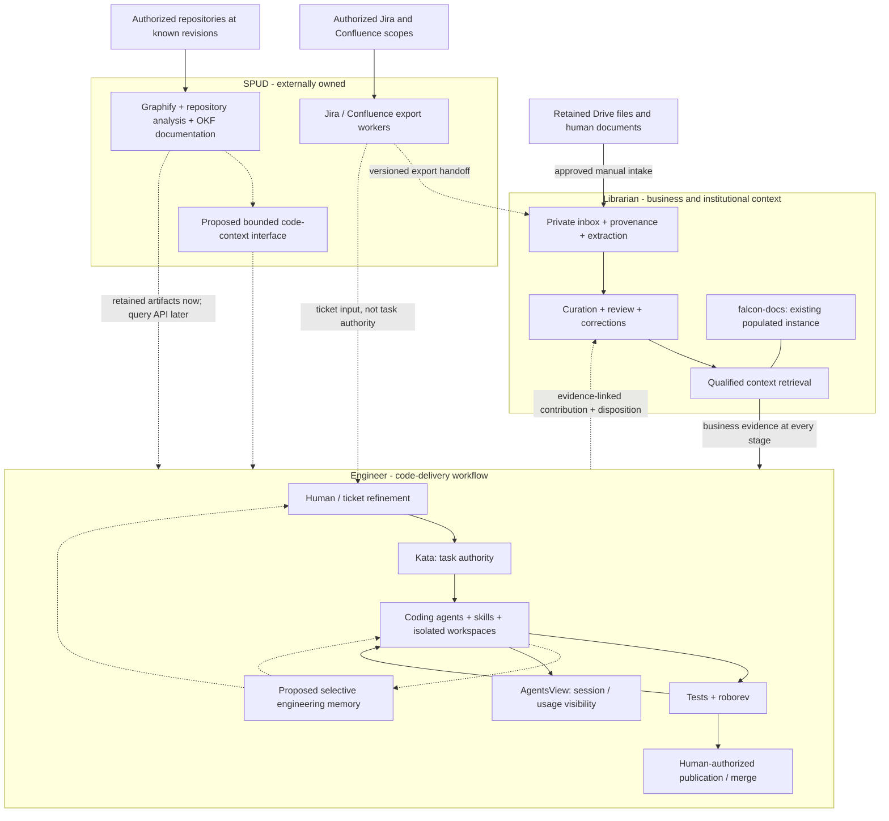
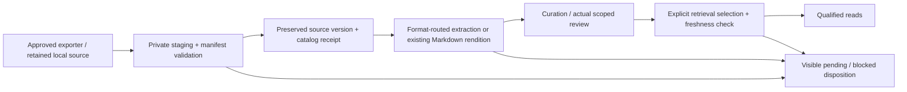
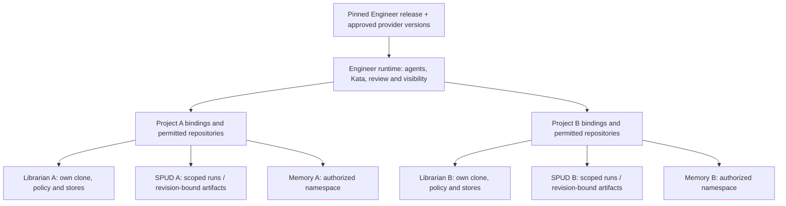

# Engineer, Librarian and SPUD: ownership and reproduction

**Date:** 2026-10-26. **Tracking:** engi-platform Kata `qt7g`.
**Status:** architecture proposal grounded in local inspection, not an installed
integration or authority to rename, migrate, deploy or change SPUD.

## Post-onboarding recommendation: 2026-10-26 (kamh)

Private GSA repositories, Forge catalog entries and explicit Kata mappings now
exist for Engineer, Librarian toolkit and SPUD (`7943`). Toolkit/corpus task
separation is also delivered; Falcon remains local and unmapped. This removes
the onboarding blocker, not the need to demonstrate a real engineering loop.
The toolkit distribution remains data-empty.

The next milestone should be **one useful, bounded task through Engineer**,
with interface checks exercised along the way, plus the existing SPUD export
contract investigation. Do not wait for every cleanup item, a new context
service or Drive support before using the platform. This recommendation updates
the delivery order below; it does not activate implementation or unattended
ingestion. Existing native Katas remain the work authority.

## The correction to the previous plan

Keep three product boundaries, but separate **who acquires material** from
**who maintains its meaning and evidence**. SPUD already provides useful
Jira/Confluence acquisition. Librarian should consume those exports, not wait
for replacement connectors before becoming useful at scale. Engineer owns the
code-delivery workflow and selective engineering memory, not every source store.

The missing link is a reliable **export-to-inbox-to-qualified-context handoff**.
Faster downloading alone does not supply source versioning, review, corrections
or retrieval freshness. Conversely, strict qualification alone does not solve
slow, manual ingestion. Both capabilities are needed.

The prior conversation is preserved unchanged, privately, at
`.local/context-inputs/tmp_convo.txt`. This proposal revises its delivery order:
acquisition integration and repeatable project setup move earlier; a new SPUD
query service and a full action ledger are not prerequisites.

## Ownership diagram (target)

Boxes express product responsibility, not organizations we can assign work to
or one process per box. This is not a live deployment diagram or proof of a
complete workflow. Dashed edges highlight integration work still needed.

Retained Drive documents use the separate inbox path; SPUD Drive acquisition
is not assumed. Engineer can deliver work using authorized local code and
retained SPUD exports before an online SPUD query interface exists. Unavailable
context must be reported; engineering memory is never a substitute for missing
business evidence.

| Responsibility | Accountable product boundary | Implementation/reuse |
| --- | --- | --- |
| Acquire Jira/Confluence material | Source-access operator; SPUD owns its exporter implementation | Reuse SPUD or its standalone exporters under approved scopes |
| Admit an export, preserve source identity and handling | Librarian instance | Receiving adapter, catalog and retained private originals |
| Drive discovery/export | Librarian intake boundary | Preserve Falcon assets; generalize its planner separately; SPUD support unconfirmed |
| Business meaning, conflicts, review and qualified reads | Librarian | Reusable toolkit plus separate program instances |
| Revision-bound structure and generated technical documentation | SPUD | Graphify and OKF artifacts; query capability requires upstream agreement or an external adapter |
| Ticket refinement, task execution, code changes and review | Engineer | Kata, agents, Superpowers, roborev; Forge restored as the managed worktree/session service on 2026-10-26 |
| Engineering experience, corrections and resumable handoffs | Engineer | Proposed project-scoped memory, separate from corpus review events |
| Transcript/usage inspection | Engineer / AgentsView | Existing visibility; not automatic memory ingestion |
| Reusable composition and onboarding | Engineer integration package | Pins and non-secret bindings to independently supplied providers |

Source purpose determines routing. Jira may supply both requirements evidence
to Librarian and change requests to Engineer. Confluence can describe business
policy or technical implementation. References may be shared; source identity
must not be duplicated into competing authorities. Generated code documentation
retained in Librarian stays attributed SPUD output, not independently verified
business or runtime truth.

## What the four checkouts actually provide

These are source/documentation observations, not a new end-to-end run or a
comparative ingestion-throughput benchmark.

| Checkout | Present evidence | Missing or materially different |
| --- | --- | --- |
| `kenn-kopy` | Engineer integration; native Kata; Pi/USAi; roborev; AgentsView; source-pinned submodules; partial installer; three provider-backed Forge/Kata mappings | No selective shared memory, demonstrated full coding/review loop or clean-host acceptance. Installer is still coupled to legacy Falcon MCP. |
| `the_librarian` | Data-empty toolkit; catalog/review stores; qualified read-only MCP; explicit selection; transcript extraction; optional Docling PDF/image lifecycle | No remote connector or durable automatic intake. Toolkit policy/store-path assumptions prevent casually sharing one install across roots. Full clones are the current instance model. |
| `falcon-docs` | Populated institutional corpus, retained original material, broader format/cohort tools, Drive metadata planner, qualified retrieval and explicit derived relationship graph | Not the distributable toolkit and not automatically on its version. Drive mount/planner is not continuous copying. Native Google exports lack a verified revision/export mapping in the current planner. |
| `aos-spud` | Local and cloud Jira/Confluence export orchestration; repository Graphify pipeline; node index, OKF documentation, HTML/archives; upstream epic/story records | No Drive connector or code-context MCP found in inspected `src/`, `docs/` and manifest. Export wrappers do not prove remote completeness or version guarantees. Query API is a proposal, not a discovered service. |

SPUD's `_handle_local_ingest` calls standalone `jira-to-markdown` or
`confluence-to-markdown`, then renders/packages outputs. It does not invoke the
repository Graphify pipeline. The latter has its own step definitions.
`GraphIndexerService` produces a flat node lookup, **not graph edges**.
Do not infer that exported Jira/Confluence content was knowledge-graphed.
Graphify here is also unrelated to Graphiti, the memory candidate.

Falcon's existing artifact-gap note records missing cited Graphify companions
in historical supplied bundles. That is a receiving-contract gap, not evidence
that current SPUD never produces them. Preserve the originals; request matching
artifacts/revisions or report unavailable evidence rather than invent edges.

### Task and naming evidence

Initial architecture-era Kata reads found `engi-platform` with 31 open issues before this
investigation, `librarian` with two open issues, and `spud` with none.
Those initial reads found both checkouts bound to `librarian`. On October 26
at 17:55 the owner approved separation: the toolkit retains `librarian`;
the instance now binds to `falcon-docs`. Native moves preserve the four
corpus-scoped issues, including withdrawn integration history and cross-project
links. The toolkit's source package and initialized stores remain data-empty.

SPUD's initially empty local Kata project did not mean no backlog: `project/epics/`
contains its upstream story records. Epic 013 still labels ingestion stories
`ready-for-test`; that is recorded workflow status, not verified deployment.
Falcon's roadmap/goals and canonical question registers provide context;
its owner-private `TODO.md` was not used as a task authority.
The later cleanup refinement created `spud#3sv9` and the toolkit receiver task
`librarian#55nx`; their actual prerequisite link remains in native Kata.

`falcon-docs` calls itself The Librarian, while `the_librarian` is the reusable
software. For architecture discussions, use **Librarian toolkit** and
**FALCON knowledge instance**. The owner selected **Engineer** (`engineer`) as
this project's product name on 2026-10-26 at 17:33, superseding `engi-platform`
as branding. The live Kata project remains `engi-platform`; all directory
renames, including `kenn-kopy` to `engineer`, are deferred. Coordinate runtime
identity/service migration separately; no database, package or SPUD rename
follows from the branding decision.

### Clean up contracts before moving directories

Engineer should maintain active refinement/coding prompts, execution profiles
and delivery orchestration. Librarian's existing `agents/refiner.md` and
`agents/coder.md` are consumer contracts, not evidence of an installed runner.
Keep provider-use and contribution/disposition requirements with Librarian;
have Engineer reference them rather than maintain competing copies. Decide
actual file moves only after comparing active prompt-loading paths.

Reusable intake/reader improvements belong in the data-empty toolkit; Falcon
keeps program policy, originals, narrative and operational records. Port a
capability with generic tests, not a directory of instance data. SPUD remains
an independently versioned dependency: interface requests go upstream, while
our receiving adapter can be maintained without taking over its implementation.

## Acquisition handoff: the first integration to build

Use SPUD as an acquisition dependency, not a subsystem to fork or rename.
The receiving adapter belongs with Librarian ingestion; Engineer configures
which instance to consult. A single adapter may accept an existing export
without launching SPUD. Scheduling can follow once restart/retry is proven.

The eventual intake process reconciles whole authorized source scopes, not
only documents preselected for a ticket. The small pilot proves mechanics;
it does not redefine the intended program corpus as a ticket-sized collection.
Broad discovery still does not automatically grant qualified retrieval selection.

The **proposed handoff manifest** should record exporter/version/run,
source system and stable remote identity, upstream version if known, export
representation, acquisition time, local SHA-256/size, attachment/companion
inventory, complete/partial scope, pagination or failed-item information,
and handling/access basis. Each representation points to its source.
An export hash establishes retained bytes, not a remote version or independent
corroboration. Unknown metadata remains unknown; an incomplete export must not
advance a complete-ingestion cursor.

On receipt: verify allowed paths/types and complete bytes; preserve older
versions; register through the existing writer; extract only when needed;
apply a separately authorized review/selection policy. Exact retries reuse
source/version/representation and request identity; changed bytes create a
linked version or visible conflict. Keep exporter progress separate from
committed catalog and published-retrieval state.

Do not require HTML generation for machine intake if the upstream standalone
exporter already supplies the needed artifacts. Do not strip source metadata
to obtain speed. Determine what exporters really preserve with a small fixture
before promising incremental ingestion, attachment coverage or remote deletion
handling. Standalone-exporter reuse must preserve its license and pin.

For Drive, retain Falcon's current originals and origin gaps. Generalize
metadata planning only after selecting an approved scope; native Docs/Sheets/
Slides need an explicit revision/export identity design. There is no basis
to re-download the corpus or declare every retained export current.

## Reproducing across projects

Separate a **software release**, a **project configuration**, and **private
project data**. Distribute only the first two when safe; provisioning a new
project must not clone Falcon's corpus, credentials, task history or memories.

This is a proposed logical topology. A shared host, Kata project name, memory
bank name or separate directory is **not** a multi-user security boundary.
Use separate OS/service identities or authenticated project authorization when
the deployment needs that boundary. Current local instances are operator-managed.
Cross-project recall is off by default; sharing a reviewed generic procedure
is a deliberate promotion, not a wildcard query across all project stores.

The onboarding contract should bind stable project/repository identities,
display names, local checkout paths, native Kata project identities, context
provider command/endpoint and protocol version, memory namespace if enabled,
model/embedding route, secret references, service/port ownership and handling.
Record exact release/runtime/schema versions. Paths and names can later change
without silently creating a new project or reusing another project's memories.
A private deployment manifest is proposed; no new configuration format is
selected or installed here.

### Concrete reproduction gaps

| Gap | Evidence and consequence | Existing work / proposed action |
| --- | --- | --- |
| Legacy MCP assumption | `dist/install.py::prerequisites` and `local_env.py::setup` require `tools/context-mcp/.venv/bin/qualified-context-mcp`; toolkit now uses `.venv/bin/librarian-mcp` | `p4ke` / `5xrm`: explicit provider configuration and preflight; preserve legacy Falcon support rather than add a blind alias |
| Installer/service drift | `7pq7` restores `install-forge-service` and four managed services at owner request; the dormant-Forge premise is superseded | `p4ke`/`rzsc`: retain independent installer and Kata storage-isolation acceptance; restored Forge does not prove fresh-host deployment |
| Runtime/version drift | Librarian decision 0002 still calls out missing complete reader/adapter lock; Engineer's full clean-host run is outstanding | Pin reproducible artifacts; validate a new isolated project and rerun without state loss |
| Instance portability | Librarian decisions 0003/0004 identify toolkit-relative policy/store homes and absolute-root index identity | Use independent full-clone instances now; make store-home/policy changes under explicit compatibility work, not a shared-root shortcut |
| Existing populated instance divergence | Falcon's old identities/layout and additional tools differ from the reusable toolkit | Inventory capability parity and rehearse any migration on a copy with recovery; never reinitialize populated stores |
| Intake throughput | Librarian roadmap and `falcon-docs#51kq` describe automation, not installed orchestration | Reuse SPUD exports and native writers; prove resumable handoff before adding watchers |
| Code-context access | SPUD exports exist; online bounded queries and complete historical companions are not established | Accept source-pinned artifacts now; seek upstream contract/support without making its roadmap ours |
| Durable engineering lessons | Existing `8cne` research is complete, but no selective-memory service exists | Evaluate the [memory contract](engineering-memory.md), not transcript capture or a lossless ledger |
| Names and task domains | Toolkit/corpus task separation is delivered; legacy runtime names remain | `5ayh` / `eb48`: inventory stable IDs/references before deferred directory/service migration |

## Delivery sequence and decision gates

This post-onboarding sequence supersedes the earlier requirement to finish
fresh-host setup and trial memory before connecting a real task. It is proposed
prioritization, not new Kata dependency edges or permission to launch agents.
Time-box cleanup to concrete behavior-preserving cuts; "all three projects are
fully refactored" is not a useful readiness gate.

| Stage | Deliverable and completion evidence | Existing work / scope |
| --- | --- | --- |
| 1. Boundaries exercised through a real workflow | One approved task goes from clarification and Kata claim through a correctly mapped Forge worktree, private Pi/Superpowers, relevant qualified context, implementation, focused checks, roborev disposition, available AgentsView visibility and evidence-linked Kata closure. Reopen/resume the workspace without duplicate work or false completion. | `engi-platform#jgcf`, with `tvbf`, `mpew` and `8vhd` retaining their separate lifecycle, synthetic-gate and compaction acceptance. An approved remaining cleanup slice can be the useful change, not a throwaway demo. |
| 2. SPUD export to Librarian evidence | Document actual producer fields/layouts; approve the receiver design; then implement and exercise one supplied export in a disposable instance, followed by one explicitly authorized source cohort. Trace an origin/version through retained bytes, receipt, extraction, actual review/selection and a qualified cited read. | Existing prerequisite `spud#3sv9 -> librarian#55nx`. Both are initially contract/design work, not permission for real intake. Reusable implementation belongs in the toolkit; deployment policy and rollout remain with the instance. |
| 3. Reliable unattended ingestion | Persist per-item progress and recovery; reconcile approved scopes; exercise retries, interruption, partial exports, changes and operator pause/replay before enabling a schedule. Report acquired, registered, extracted, awaiting review and retrieval-ready separately. | Refine approved toolkit implementation children and deliberately activate the instance roadmap `falcon-docs#51kq`. It is still parked; a scheduler alone does not complete it. |
| 4. Drive as another acquisition adapter | Feed the same handoff through one approved Drive scope. Preserve source permissions/handling, stable IDs, upstream versions where available, export representation and change/deletion semantics. | A separate design slice after the common receiver/recovery contract is proven. Reuse Falcon's planner evidence; do not assume SPUD already has Drive support or replace retained originals. |
| 5. Selective engineering memory | After the first real workflow, compare explicit bounded handoffs/lessons against the structured-record baseline using the existing synthetic pilot gates. Adopt a service only if it reduces repeated investigation without losing correction, provenance or scope. | [Memory proposal](engineering-memory.md); prior research is complete, implementation is not. Can proceed independently of Drive and wider connector rollout once its own handling/model decisions are approved. |
| 6. Reproduction and expansion | Install an empty independent project, rerun without data loss, and restore it from an exercised backup. Verify task/provider/store separation across two synthetic projects before promoting multi-project deployment. | `engi-platform#f47m`, `0sfx`, `p4ke`, `5xrm`. Fix relevant portability gaps throughout stages 1-3; the full fresh-host/restore gate is required before distribution claims, not before using the current host. |

Two tracks can advance independently after the relevant cleanup/design gates:
the Engineer pilot and the producer-contract investigation. The receiver design
really depends on producer evidence; unrelated documentation cleanup and all
future connectors do not block the first local workflow.

### Harden interfaces, not a new platform framework

Keep the existing authority split executable at the points where products
meet. `engi-platform#f47m` is the concrete first provider boundary: explicit
executable/reader/root/selection, preserved Falcon compatibility, visible
configuration failures and no accidental instance-state substitution.
`0sfx` addresses native Kata provisioning, not a replacement CLI wrapper.
`qc96`, `librarian#7bna` and `falcon-docs#939r` already cover current-guidance
cleanup and safe toolkit/instance consolidation.

For each supplied context packet, preserve origin/revision, inspected scope,
qualification and freshness; distinguish unavailable, partial and stale data
from an authoritative empty answer. Do not collapse review, retrieval selection
and extraction into one "ingested" flag. Engineer owns execution and its
permissions; a source document or memory cannot authorize a task mutation,
publication or broader access.

Start with fixtures for wrong provider/root, missing/stale context, failed
review and interruption. Exercise the exact affected workflow rather than
building a giant cross-product test suite first. One integration scenario may
provide evidence to several Katas, but each retains its own unmet criteria.
Worktree/project routing is not access isolation. Before broader users or
untrusted execution, separately agree and exercise OS/service or authenticated
authorization boundaries (`vd8j`); do not resurrect removed native-Kata guards
or claim local routing checks establish security.

### What the Engineer pilot must establish

Demonstrate the actual model-backed path, not only tool discovery or green
health endpoints. The run must bind task, repository/worktree, commit, test
result, review job/disposition and session identity. Check the visibility
actually configured in AgentsView; a missing session or review-usage gap is a
reported limitation, not permission to enable full transcript capture.
Native Kata remains authoritative after interruption and explicit closure.

Use synthetic failure cases without stopping production services. A failing
check or unresolved review must not be presented as completion; a missing
optional context source must be disclosed, while missing required evidence
blocks the affected decision. Human-input and publication gates must remain
visible. Closure of `jgcf` would not establish real compaction (`8vhd`), every
AgentsView client (`3c2c`) or no-session review accounting (`fjyf`).

The next expanded acceptance is manual Jira intake (`99gr`) and the authorized
ticket-to-PR loop (`d8v5`). Private repository creation did not authorize future
pushes, PRs or merges. The former Forge guidance/workspace tasks `k03a` and
`j54x` were soft-deleted during retirement and still appear in older dependency
links. Reconcile their required acceptance with the owner before relying on
readiness for `mpew`/`d8v5`; neither restoration nor completion is implied.
Do not silently reselect an old application ticket or remap its repository.

### Automation order and source safeguards

Use this progression: explicit dry-run and import, repeatable batch, durable
resume/retry, then an operator-enabled schedule. Reuse existing supported
writers and exporter manifests; add only genuinely missing receiving metadata.
Prefer a small bounded worker using existing persistence over a new event bus,
generic connector framework or mandatory web service.

An exact retry must not duplicate a receipt/version or extraction. Changed
bytes must not overwrite previous evidence; a partial source listing or
ambiguous commit must not advance a "complete" checkpoint. Scope inventories,
pagination failures, rate limits and permission loss need visible dispositions.
Do not infer upstream deletion from an incomplete crawl. Agree how revocation
affects future retrieval while preserving governed retained originals before
real unattended operation. Automated acquisition does not authorize automatic
review, qualification, selection or publication.

SPUD's export orchestration is useful reuse, not proof that this whole lifecycle
already exists. Prefer supported Markdown/artifacts without HTML/ZIP work when
the producer contract permits it. Route Jira change requests to Engineer and
business evidence to Librarian using shared source references, not competing
task authorities.

Drive native Docs/Sheets/Slides need an explicit revision-to-export mapping;
an export hash proves bytes, not a remote revision. Folder/shortcut exclusions,
permission changes, failed exports and change-cursor recovery belong in that
connector's acceptance. Start small to prove mechanics, then reconcile whole
approved scopes rather than quietly limiting the intended corpus to one ticket.

### Defer capability expansion until there is an observed need

SPUD's queryable code-context direction remains valuable, but revision-bound
local artifacts and direct repository reads can support the first workflow.
Use that workflow to identify which symbol, dependency or source-range lookups
need a bounded upstream query interface; do not make a new SPUD MCP service or
knowledge graph the entry fee for integration. Upstream changes require its
maintainer agreement.

Do not add cloud deployment, directory migration, automatic agent dispatch or
full-session memory capture to these milestones. The decisions needed to
activate the next slices are the bounded pilot change, its acceptance/model
scope, the producer/receiver design and first authorized source cohort.
Drive access and memory handling/model policy are later separate approvals.

## Skills and optional investigation: Superpowers, REA and Hindsight

**Owner update, 2026-10-26 18:28:** defer REA; no installation or pilot is in
active scope. Prepare Hindsight configuration under `svg1`; `zbww` tracks its
gated synthetic evaluation. The REA assessment below is retained rationale,
not queued implementation.

The owner's follow-up asks where Hindsight fits and whether Reverse Engineer
Anything (REA) should join the agent pipeline. The evaluated project is
[`morluto/rea`](https://github.com/morluto/rea), not similarly named forks.
This is a capability/fit recommendation, not an installed skill or permission
to analyze a new target.

| Component | Role in Engineer | Deliberate limit |
| --- | --- | --- |
| Superpowers | Existing working method for design, implementation, debugging and verification | Not a code index or durable shared memory backend |
| REA | Optional evidence-gathering capability during refinement, investigation or debugging when source alone cannot answer the question | Not a mandatory pipeline phase, ordinary repository explorer or replacement for SPUD |
| Hindsight | Leading service candidate for selective engineering memory, available across phases and sessions | Not adopted; compare with the structured-record baseline and Mem0 under the [memory pilot](engineering-memory.md) |
| SPUD | Revision-bound code-context production and maintained technical artifacts | Does not acquire task authority merely because an investigation produces useful code evidence |
| Librarian | Qualified institutional/business evidence | REA observations and agent memories do not become business truth without the normal contribution/review path |

REA is more than a prompt skill: it supplies an MCP/CLI analysis toolchain and
matching workflow instructions. Its own
[skill](https://github.com/morluto/rea/blob/779d548c4e553f01cb1aaf61d6949885c6f02806/.agents/skills/reverse-engineer-anything/SKILL.md)
explicitly excludes ordinary architecture analysis of complete source
repositories. The useful cases here are authorized legacy/packaged applications,
.NET/native artifacts, JavaScript/Electron bundles and requested runtime
behavior not established by available source. Native/deep analysis can require
separate engines; static JavaScript and managed inspection have lighter routes.

Proposed routing: task question -> ordinary source/SPUD context -> REA only
if an artifact/runtime evidence gap remains -> evidence-linked design or
debugging conclusion -> ordinary implementation and review. Keep target
hash/revision, tool/profile version, evidence IDs, coverage and unknowns with
findings. Useful technical artifacts can inform SPUD integration later;
Hindsight should retain only selected reusable lessons and references, not
silently ingest REA evidence bundles, source bodies or runtime captures.

Before adopting it, select one authorized non-sensitive fixture or shipped
artifact with independently known behavior. Compare ordinary tools with REA
on the same bounded questions, using the reference behavior as the check.
Require evidence-linked answers, explicit unresolved questions, reproducible
target identity, successful cleanup and no unapproved target execution or
network access. Record elapsed time, calls/context cost and manual corrections.
Keep REA only if it answers an otherwise unmet question or reduces effort
without weakening evidence. No demonstrated need means no mandatory dependency.

REA's pinned installation docs list Pi and Copilot support; that does not
establish compatibility with our private Forge/Pi profile. A future pilot
should use an explicitly scoped, version-pinned stdio registration, matching
skill, and only the relevant tool families, without global setup. Family
selection disables out-of-scope MCP tools but is not an OS sandbox or a
read-only guarantee. Runtime launch/attach, browser actions, instrumentation
and capture remain separate approvals; untrusted targets need actual isolation.
Test profile/config preservation and uninstall before adopting the integration.

Hindsight's placement is earlier than the table numbering might suggest:
trial it after the first real workflow, independently of connector scale-out.
It is the best first service candidate from the inspected shortlist, not a
claim of comparative superiority. Avoid default automatic conversation/history
ingestion; begin with explicit selected-record retain/recall and measure
correction, stale-record handling, cross-project isolation and useful handoffs.
Superpowers supplies method, REA supplies optional investigative tools, and
Hindsight could preserve selected experience; they solve different problems.

## Evidence map

Local paths below identify inspected sources, not files shipped together.
This checkout was clean at `51a47de3450a4bb01fe141298126aaa79802d6e6`
before this work. Neighbor observations include existing uncommitted changes:

| Source baseline | Inspected evidence |
| --- | --- |
| Engineer `51a47de` | [README](../README.md), [workflow history](engineering-workflow.md), [installer](../dist/README.md), `dist/install.py`, `scripts/local_env.py`, native Kata records |
| Librarian `2f1cd9f` plus dirty roadmap/decision 0006 | [`README`](../../the_librarian/README.md), [`ROADMAP`](../../the_librarian/ROADMAP.md), decisions [0002](../../the_librarian/docs/decisions/0002-updateable-distribution.md), [0003](../../the_librarian/docs/decisions/0003-store-compatibility.md), [0004](../../the_librarian/docs/decisions/0004-instance-topology.md), [0007](../../the_librarian/docs/decisions/0007-execution-traces.md), [contributions](../../the_librarian/agents/contributions.md) |
| Falcon `0adcad5` plus existing corpus/tool edits | [`README`](../../falcon-docs/README.md), [`long-term goals`](../../falcon-docs/REFERENCE/planning/long-term-goals.md), [`Drive planner`](../../falcon-docs/tools/drive-intake/README.md), [`artifact-gap note`](../../falcon-docs/REFERENCE/notes/2026-10-23-spud-graph-artifact-gap.md), `.kata.toml`; no original corpus imported here |
| SPUD `c80837a` plus local instructions/binding edits | [`README`](../../aos-spud/README.md), [`ingestion epic`](../../aos-spud/project/epics/epic-013-jira-and-confluence-knowledge-ingestion/README.md), [`CLI`](../../aos-spud/src/spud/api/cli.py), [`ingest runner`](../../aos-spud/src/spud/services/ingest_runner.py), [`steps`](../../aos-spud/src/spud/services/steps.py), [`node index`](../../aos-spud/src/spud/services/index_service.py) |

The post-onboarding `kamh` pass reread the private original request/conclusion,
current context and live native Kata bodies/comments/links. It also reconfirmed
the hard-coded provider path in `dist/install.py` and `scripts/local_env.py`.
Neighbor capability descriptions above retain their earlier inspected
baselines; this pass did not rerun SPUD or independently audit its latest
exporters. It started no ingestion, workflow pilot or memory trial.

The follow-up read public Hindsight README, coding-agent/MCP documentation and
Mem0's OSS overview, plus REA README, skill, package metadata and installation/
MCP contracts at `779d548c4e553f01cb1aaf61d6949885c6f02806` (package metadata
6.8.0, MIT). Main-branch documentation is not verification of the currently
published npm artifact. No REA command, model benchmark or installer was run.

The session-history search did not recover the recent architecture discussion;
the supplied conversation and existing local context are the historical basis.
No claim of missing capability applies to uninspected SPUD branches/services.
