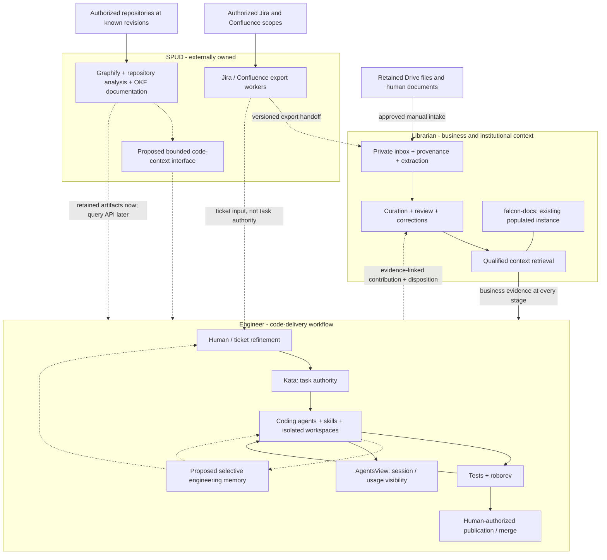
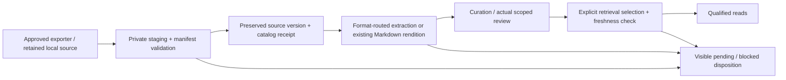
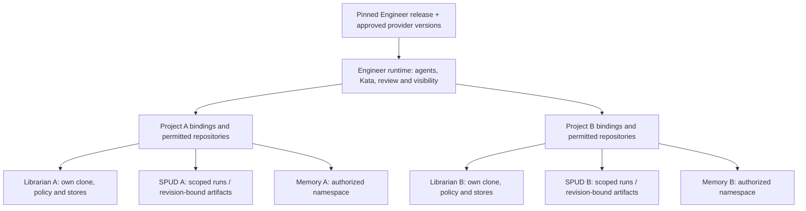

# Engineer, Librarian and SPUD: ownership and reproduction

**Date:** 2026-10-26. **Tracking:** engi-platform Kata `qt7g`.
**Status:** architecture proposal grounded in local inspection, not an installed
integration or authority to rename, migrate, deploy or change SPUD.

## The correction to the previous plan

Keep three product boundaries, but separate **who acquires material** from
**who maintains its meaning and evidence**. SPUD already provides useful
Jira/Confluence acquisition. Librarian should consume those exports, not wait
for replacement connectors before becoming useful at scale. Engineer owns the
code-delivery workflow and selective engineering memory, not every source store.

The missing link is a reliable **export-to-inbox-to-qualified-context handoff**.
Faster downloading alone does not supply source versioning, review, corrections
or retrieval freshness. Conversely, strict qualification alone does not solve
slow, manual ingestion. Both capabilities are needed.

The prior conversation is preserved unchanged, privately, at
`.local/context-inputs/tmp_convo.txt`. This proposal revises its delivery order:
acquisition integration and repeatable project setup move earlier; a new SPUD
query service and a full action ledger are not prerequisites.

## Ownership diagram (target)

Boxes express product responsibility, not organizations we can assign work to
or one process per box. This is not a live deployment diagram or proof of a
complete workflow. Dashed edges highlight integration work still needed.

Retained Drive documents use the separate inbox path; SPUD Drive acquisition
is not assumed. Engineer can deliver work using authorized local code and
retained SPUD exports before an online SPUD query interface exists. Unavailable
context must be reported; engineering memory is never a substitute for missing
business evidence.

| Responsibility | Accountable product boundary | Implementation/reuse |
| --- | --- | --- |
| Acquire Jira/Confluence material | Source-access operator; SPUD owns its exporter implementation | Reuse SPUD or its standalone exporters under approved scopes |
| Admit an export, preserve source identity and handling | Librarian instance | Receiving adapter, catalog and retained private originals |
| Drive discovery/export | Librarian intake boundary | Preserve Falcon assets; generalize its planner separately; SPUD support unconfirmed |
| Business meaning, conflicts, review and qualified reads | Librarian | Reusable toolkit plus separate program instances |
| Revision-bound structure and generated technical documentation | SPUD | Graphify and OKF artifacts; query capability requires upstream agreement or an external adapter |
| Ticket refinement, task execution, code changes and review | Engineer | Kata, agents, Superpowers, roborev; Forge restored as the managed worktree/session service on 2026-10-26 |
| Engineering experience, corrections and resumable handoffs | Engineer | Proposed project-scoped memory, separate from corpus review events |
| Transcript/usage inspection | Engineer / AgentsView | Existing visibility; not automatic memory ingestion |
| Reusable composition and onboarding | Engineer integration package | Pins and non-secret bindings to independently supplied providers |

Source purpose determines routing. Jira may supply both requirements evidence
to Librarian and change requests to Engineer. Confluence can describe business
policy or technical implementation. References may be shared; source identity
must not be duplicated into competing authorities. Generated code documentation
retained in Librarian stays attributed SPUD output, not independently verified
business or runtime truth.

## What the four checkouts actually provide

These are source/documentation observations, not a new end-to-end run or a
comparative ingestion-throughput benchmark.

| Checkout | Present evidence | Missing or materially different |
| --- | --- | --- |
| `kenn-kopy` | Engineer integration; native Kata; Pi/USAi; roborev; AgentsView; source-pinned submodules; partial installer | No selective shared memory, complete multi-project onboarding or clean-host acceptance. Installer is still coupled to legacy Falcon MCP. |
| `the_librarian` | Data-empty toolkit; catalog/review stores; qualified read-only MCP; explicit selection; transcript extraction; optional Docling PDF/image lifecycle | No remote connector or durable automatic intake. Toolkit policy/store-path assumptions prevent casually sharing one install across roots. Full clones are the current instance model. |
| `falcon-docs` | Populated institutional corpus, retained original material, broader format/cohort tools, Drive metadata planner, qualified retrieval and explicit derived relationship graph | Not the distributable toolkit and not automatically on its version. Drive mount/planner is not continuous copying. Native Google exports lack a verified revision/export mapping in the current planner. |
| `aos-spud` | Local and cloud Jira/Confluence export orchestration; repository Graphify pipeline; node index, OKF documentation, HTML/archives; upstream epic/story records | No Drive connector or code-context MCP found in inspected `src/`, `docs/` and manifest. Export wrappers do not prove remote completeness or version guarantees. Query API is a proposal, not a discovered service. |

SPUD's `_handle_local_ingest` calls standalone `jira-to-markdown` or
`confluence-to-markdown`, then renders/packages outputs. It does not invoke the
repository Graphify pipeline. The latter has its own step definitions.
`GraphIndexerService` produces a flat node lookup, **not graph edges**.
Do not infer that exported Jira/Confluence content was knowledge-graphed.
Graphify here is also unrelated to Graphiti, the memory candidate.

Falcon's existing artifact-gap note records missing cited Graphify companions
in historical supplied bundles. That is a receiving-contract gap, not evidence
that current SPUD never produces them. Preserve the originals; request matching
artifacts/revisions or report unavailable evidence rather than invent edges.

### Task and naming evidence

Native Kata reads found `engi-platform` with 31 open issues before this
investigation, `librarian` with two open issues, and `spud` with none.
Those initial reads found both checkouts bound to `librarian`. On October 26
at 17:55 the owner approved separation: the toolkit retains `librarian`;
the instance now binds to `falcon-docs`. Native moves preserve the four
corpus-scoped issues, including withdrawn integration history and cross-project
links. The toolkit's source package and initialized stores remain data-empty.

SPUD's empty local Kata project does not mean no backlog: `project/epics/`
contains its upstream story records. Epic 013 still labels ingestion stories
`ready-for-test`; that is recorded workflow status, not verified deployment.
Falcon's roadmap/goals and canonical question registers provide context;
its owner-private `TODO.md` was not used as a task authority.

`falcon-docs` calls itself The Librarian, while `the_librarian` is the reusable
software. For architecture discussions, use **Librarian toolkit** and
**FALCON knowledge instance**. The owner selected **Engineer** (`engineer`) as
this project's product name on 2026-10-26 at 17:33, superseding `engi-platform`
as branding. The live Kata project remains `engi-platform`; all directory
renames, including `kenn-kopy` to `engineer`, are deferred. Coordinate runtime
identity/service migration separately; no database, package or SPUD rename
follows from the branding decision.

### Clean up contracts before moving directories

Engineer should maintain active refinement/coding prompts, execution profiles
and delivery orchestration. Librarian's existing `agents/refiner.md` and
`agents/coder.md` are consumer contracts, not evidence of an installed runner.
Keep provider-use and contribution/disposition requirements with Librarian;
have Engineer reference them rather than maintain competing copies. Decide
actual file moves only after comparing active prompt-loading paths.

Reusable intake/reader improvements belong in the data-empty toolkit; Falcon
keeps program policy, originals, narrative and operational records. Port a
capability with generic tests, not a directory of instance data. SPUD remains
an independently versioned dependency: interface requests go upstream, while
our receiving adapter can be maintained without taking over its implementation.

## Acquisition handoff: the first integration to build

Use SPUD as an acquisition dependency, not a subsystem to fork or rename.
The receiving adapter belongs with Librarian ingestion; Engineer configures
which instance to consult. A single adapter may accept an existing export
without launching SPUD. Scheduling can follow once restart/retry is proven.

The eventual intake process reconciles whole authorized source scopes, not
only documents preselected for a ticket. The small pilot proves mechanics;
it does not redefine the intended program corpus as a ticket-sized collection.
Broad discovery still does not automatically grant qualified retrieval selection.

The **proposed handoff manifest** should record exporter/version/run,
source system and stable remote identity, upstream version if known, export
representation, acquisition time, local SHA-256/size, attachment/companion
inventory, complete/partial scope, pagination or failed-item information,
and handling/access basis. Each representation points to its source.
An export hash establishes retained bytes, not a remote version or independent
corroboration. Unknown metadata remains unknown; an incomplete export must not
advance a complete-ingestion cursor.

On receipt: verify allowed paths/types and complete bytes; preserve older
versions; register through the existing writer; extract only when needed;
apply a separately authorized review/selection policy. Exact retries reuse
source/version/representation and request identity; changed bytes create a
linked version or visible conflict. Keep exporter progress separate from
committed catalog and published-retrieval state.

Do not require HTML generation for machine intake if the upstream standalone
exporter already supplies the needed artifacts. Do not strip source metadata
to obtain speed. Determine what exporters really preserve with a small fixture
before promising incremental ingestion, attachment coverage or remote deletion
handling. Standalone-exporter reuse must preserve its license and pin.

For Drive, retain Falcon's current originals and origin gaps. Generalize
metadata planning only after selecting an approved scope; native Docs/Sheets/
Slides need an explicit revision/export identity design. There is no basis
to re-download the corpus or declare every retained export current.

## Reproducing across projects

Separate a **software release**, a **project configuration**, and **private
project data**. Distribute only the first two when safe; provisioning a new
project must not clone Falcon's corpus, credentials, task history or memories.

This is a proposed logical topology. A shared host, Kata project name, memory
bank name or separate directory is **not** a multi-user security boundary.
Use separate OS/service identities or authenticated project authorization when
the deployment needs that boundary. Current local instances are operator-managed.
Cross-project recall is off by default; sharing a reviewed generic procedure
is a deliberate promotion, not a wildcard query across all project stores.

The onboarding contract should bind stable project/repository identities,
display names, local checkout paths, native Kata project identities, context
provider command/endpoint and protocol version, memory namespace if enabled,
model/embedding route, secret references, service/port ownership and handling.
Record exact release/runtime/schema versions. Paths and names can later change
without silently creating a new project or reusing another project's memories.
A private deployment manifest is proposed; no new configuration format is
selected or installed here.

### Concrete reproduction gaps

| Gap | Evidence and consequence | Existing work / proposed action |
| --- | --- | --- |
| Legacy MCP assumption | `dist/install.py::prerequisites` and `local_env.py::setup` require `tools/context-mcp/.venv/bin/qualified-context-mcp`; toolkit now uses `.venv/bin/librarian-mcp` | `p4ke` / `5xrm`: explicit provider configuration and preflight; preserve legacy Falcon support rather than add a blind alias |
| Installer/service drift | `7pq7` restores `install-forge-service` and four managed services at owner request; the dormant-Forge premise is superseded | `p4ke`/`rzsc`: retain independent installer and Kata storage-isolation acceptance; restored Forge does not prove fresh-host deployment |
| Runtime/version drift | Librarian decision 0002 still calls out missing complete reader/adapter lock; Engineer's full clean-host run is outstanding | Pin reproducible artifacts; validate a new isolated project and rerun without state loss |
| Instance portability | Librarian decisions 0003/0004 identify toolkit-relative policy/store homes and absolute-root index identity | Use independent full-clone instances now; make store-home/policy changes under explicit compatibility work, not a shared-root shortcut |
| Existing populated instance divergence | Falcon's old identities/layout and additional tools differ from the reusable toolkit | Inventory capability parity and rehearse any migration on a copy with recovery; never reinitialize populated stores |
| Intake throughput | Librarian roadmap and `falcon-docs#51kq` describe automation, not installed orchestration | Reuse SPUD exports and native writers; prove resumable handoff before adding watchers |
| Code-context access | SPUD exports exist; online bounded queries and complete historical companions are not established | Accept source-pinned artifacts now; seek upstream contract/support without making its roadmap ours |
| Durable engineering lessons | Existing `8cne` research is complete, but no selective-memory service exists | Evaluate the [memory contract](engineering-memory.md), not transcript capture or a lossless ledger |
| Names and task domains | Toolkit/corpus task separation is delivered; legacy runtime names remain | `5ayh` / `eb48`: inventory stable IDs/references before deferred directory/service migration |

## Delivery sequence and decision gates

1. **Agree boundaries and inventory.** Adopt or amend this proposal; decide
   task-scope separation and target onboarding audience. Record logical names
   now; defer path/service/store renames. No upstream SPUD commitment assumed.
2. **Make one repeatable empty project.** Reconcile installer drift using
   `p4ke`/`5xrm`, retain native Kata, select a supplied Librarian provider and
   verify two isolated synthetic projects cannot mix state. Fresh installation
   and restoration are separate acceptance runs. No cloud requirement.
3. **Prove one export handoff.** Under `falcon-docs#51kq` after deliberate
   activation, ingest a permitted SPUD Confluence export through the receiving
   contract, then exercise duplicates, changed versions, partial failures and
   interrupted publication. Start with existing exports, not a new crawler.
4. **Pilot selective memory in parallel.** Synthetic scoped records, two
   agents and two projects; compare a plain structured-record baseline with
   Hindsight, then Mem0 if useful. Evaluate reduced repeated investigation,
   correction handling and privacy before any automatic capture.
5. **Connect one real ticket.** Reuse `99gr`, `jgcf` and `d8v5`: refinement,
   Kata, coding, review and evidence-linked handoff. Missing provider data stays
   explicit. A demonstrated local commit is not publication authorization.
6. **Scale only demonstrated contracts.** Add Drive automation, more instances,
   upstream code-query support and approved GSA-hosted services as separate
   decisions. Reproduction must not wait on every future capability.

The next consequential choices are the target engineer environment, the
Librarian task split, the first permitted export/source scope, and the memory
pilot's hosting/model/data policy. They are not silently settled by this draft.

## Evidence map

Local paths below identify inspected sources, not files shipped together.
This checkout was clean at `51a47de3450a4bb01fe141298126aaa79802d6e6`
before this work. Neighbor observations include existing uncommitted changes:

| Source baseline | Inspected evidence |
| --- | --- |
| Engineer `51a47de` | [README](../README.md), [workflow history](engineering-workflow.md), [installer](../dist/README.md), `dist/install.py`, `scripts/local_env.py`, native Kata records |
| Librarian `2f1cd9f` plus dirty roadmap/decision 0006 | [`README`](../../the_librarian/README.md), [`ROADMAP`](../../the_librarian/ROADMAP.md), decisions [0002](../../the_librarian/docs/decisions/0002-updateable-distribution.md), [0003](../../the_librarian/docs/decisions/0003-store-compatibility.md), [0004](../../the_librarian/docs/decisions/0004-instance-topology.md), [0007](../../the_librarian/docs/decisions/0007-execution-traces.md), [contributions](../../the_librarian/agents/contributions.md) |
| Falcon `0adcad5` plus existing corpus/tool edits | [`README`](../../falcon-docs/README.md), [`long-term goals`](../../falcon-docs/REFERENCE/planning/long-term-goals.md), [`Drive planner`](../../falcon-docs/tools/drive-intake/README.md), [`artifact-gap note`](../../falcon-docs/REFERENCE/notes/2026-10-23-spud-graph-artifact-gap.md), `.kata.toml`; no original corpus imported here |
| SPUD `c80837a` plus local instructions/binding edits | [`README`](../../aos-spud/README.md), [`ingestion epic`](../../aos-spud/project/epics/epic-013-jira-and-confluence-knowledge-ingestion/README.md), [`CLI`](../../aos-spud/src/spud/api/cli.py), [`ingest runner`](../../aos-spud/src/spud/services/ingest_runner.py), [`steps`](../../aos-spud/src/spud/services/steps.py), [`node index`](../../aos-spud/src/spud/services/index_service.py) |

The session-history search did not recover the recent architecture discussion;
the supplied conversation and existing local context are the historical basis.
No claim of missing capability applies to uninspected SPUD branches/services.
